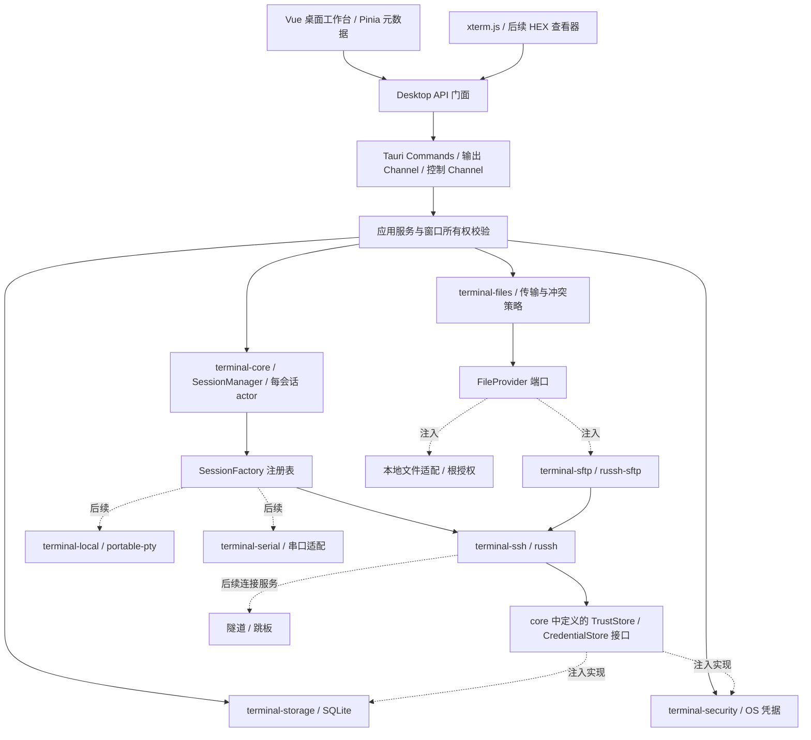

# 系统架构与模块边界

日期：2026-10-15。当前六个领域 crate 与桌面工作区已落源码（files/sftp首批实现见末尾）；以下同时保留后续目标结构。实现待验证，实际差异见 [实施状态](17-implementation-status.md)。

## 1. 总体结构



图中的箭头表示调用关系；crate 编译依赖以第 3 节为准，不能让 core 编译依赖具体实现。

## 2. 关键分层

| 层                  | 负责                                              | 不负责                              |
| ------------------- | ------------------------------------------------- | ----------------------------------- |
| 视图与交互          | 主机、标签、错误、信任与认证弹窗、终端焦点        | 网络连接、私钥解析、数据库 SQL      |
| 前端服务            | 类型化 IPC、输入排队、帧解析、ACK、错误映射       | 存储密码或把字节塞入 Pinia          |
| Tauri 适配/应用服务 | DTO 校验、窗口上下文、组装依赖、Channel、业务编排 | 实现 SSH 协议或持有全局协议大锁     |
| 通用会话 core       | ID、状态、能力、actor 控制、限额、取消、输出事件  | Tauri 类型、WebView、russh/PTY 细节 |
| 传输适配器          | 具体协议连接、I/O、resize、专用控制、资源释放     | UI、任意 SQL、全局 UI event 广播    |
| 存储与安全          | 持久化、迁移、凭据库、数据脱敏                    | 终端渲染、自动执行用户命令          |

首期一个主窗口；所有 session 绑定创建窗口。为未来多窗口保留 owner 标识，但不提前实现拖出标签或跨窗口转移。

凭据库分 password/privateKey，主机专属密码与公共凭据通过 owner_profile_id 隔离。安全服务协调 OS 秘密与 SQLite 引用的两阶段保存/清理；core 只定义不含序列化能力的 PrivateKeyMaterial 端口返回值。私钥导入后不依赖源文件，会话配置只含一种主要认证及凭据引用；主机公共 DTO 隐藏专属 ID，Rust 内部组装实际连接配置，临时连接只准用公共凭据。前端密码仅存在短期表单与 IPC 参数，不进入 Pinia 主机对象。

## 3. Rust 编译依赖

```text
src-tauri ──> terminal-core
          ├─> terminal-ssh ──────> terminal-core
          ├─> terminal-storage ─> terminal-core
          └─> terminal-security > terminal-core

后续 terminal-local / terminal-serial ──> terminal-core
src-tauri ──> terminal-files（FileProvider / 受界复制）
             └─> terminal-sftp ──> terminal-files + terminal-ssh
本地文件适配隔离于 terminal-files 平台模块，不依赖 portable-pty
后续 terminal-tunnel ──> terminal-ssh（受控连接服务 API）
```

core 的模型与端口允许使用 serde、bytes、Tokio 通道、async-trait 等基础库；不能依赖 Tauri、SQLx、russh、serialport、portable-pty。`CredentialStore`、`HostTrustStore` 等端口在 core 中定义；具体适配器实现。src-tauri 作为 composition root 注入，避免 SSH 与 storage/security 互相编译依赖。

采用每会话 actor 单独持有协议对象，manager 只保存轻量句柄。读取会话表的锁只用于查找、复制句柄，不跨 await。I/O 与流桥接分离，细节见 [会话模型](04-session-model.md)。

## 4. 目录职责

| 路径                                       | 当前职责                             |
| ------------------------------------------ | ------------------------------------ |
| src/modules/hosts、credentials、settings   | 主机、凭据元数据、设置               |
| src/modules/terminal、workspace            | xterm 实例、输入路由、标签组与分屏   |
| src/modules/files                          | 单终端 SFTP 浏览和轻量传输队列       |
| src/services/desktop                       | 唯一 invoke/Channel 门面             |
| src/services/commands                      | 命令注册、快捷键与焦点路由           |
| crates/terminal-core、terminal-ssh         | 通用会话及 SSH 协议                  |
| crates/terminal-storage、terminal-security | SQLite 与 OS 凭据                    |
| crates/terminal-files、terminal-sftp       | 文件 DTO/有界复制与 SFTP provider    |
| src-tauri/src/commands、ipc、state.rs      | owner 校验、原生交互、流桥与依赖装配 |

根 Cargo workspace 使用 resolver 3、edition 2024，统一 release profile 和 Cargo.lock。Local、Serial、独立 TransferManager、双栏端点及连接租约尚未创建或完成，开发对应功能时再引入实际模块。

## 5. 前端与终端生命周期

`WorkspaceStore.tabs` 保存终端元数据，groups 保存标签组/布局树与聚焦 terminalId，tabIds 包含固定 home/sftp 和动态组 ID。activeId 为组 ID，active 为聚焦终端；固定页不创建 session/xterm。homeSection 管理首页导航，tabPosition 只改变布局。

`TerminalRegistry` 用普通 Map 按稳定 terminalId 保存 xterm、当前 session 绑定、代次、订阅和输入队列，不深度响应式化。重连只更换 sessionId，不改 Vue key。未来独立双栏将使用单独端点/浏览器引用，不伪造终端；目前固定 SFTP 页仍是占位。

建立连接前先创建 Tab、terminalId 与终端宿主并装好 Channel handlers，即使 open_session 同步失败也保留视图。握手期间展示状态，Connected 前关闭远端键盘写入，但保留滚动/选择/复制/搜索。切标签不卸载 xterm；隐藏终端继续解析和 ACK，只减少不必要的渲染与 resize。ResizeObserver 只对可见且非零尺寸的宿主调用 fit。

后端终态只回收连接及其订阅，不清空/销毁终端，也不移除 Tab；只有用户关闭 Tab/窗口才 dispose 视图。重连串行结束旧连接的数据排空，在原终端加入可信本地状态分界，再绑定新 session/Channel，继续追加到同一 xterm。旧 session 的 ACK、帧序号与 offset 不得延续到新连接，也不能让其迟到状态覆盖新状态；见 [IPC 规则](06-ipc-and-streaming.md)。

UI 使用 Naive UI 现成组件及 `src/components/ui/` 薄适配，NConfigProvider 管理主题，页面只保留必要布局。工作区标签由 workspace/WorkspaceTabs.vue 自定义实现，只派发激活/关闭/菜单等事件，store.ts 维护唯一标签状态与临时连接序号；终端宿主独立于导航组件，设置内标签仍使用 Naive UI。系统原生菜单/文件选择继续由 Tauri 负责，详见 [UI 选型](13-ui-stack.md)。

## 6. 扩展接口

- `SessionKind`：首期 `ssh`；模型认可 `local`/`serial`，未注册的工厂返回 `UNSUPPORTED_SESSION_KIND`，UI 不展示可连接入口。
- `SessionFactory`：验证该 kind 的版本化配置，创建 driver；`available_session_kinds` 返回已注册工厂能力。
- `SessionCapabilities`：如 resize、PTY、binaryOutput、serialControl；通用 UI 根据能力启用，不根据 `kind === ssh` 推断。
- `SessionControl`：通用 Write/Resize；未来 SerialControl 为受类型约束的专用扩展，不提供 `executeAnything` 或任意 JSON 逃逸口。
- 输出恒为 bytes；终端/HEX 是两个消费视图。将来单 session 在二者切换要定义缓存与重放范围，不承诺无限历史。
- 配置使用版本化 discriminated union，DTO 映射到 core typed enum；不把 ssh 地址/用户名放进所有会话必填字段。

为防过度抽象，第一版只实现 SSH 分支，但使用 fake driver 检验管理器不引用 SSH 类型；Local/Serial 控制与配置以设计保留。

## 7. SSH connection 与 terminal session

M1/M2 默认一个 terminal session 拥有一个 SSH connection 和一个 Shell channel，关闭时一并回收。提前区分 connectionId 与 sessionId，但不做跨主机池化。

后续独立 SFTP/隧道计划引入受控 `SshConnectionService` 为 Shell/SFTP/隧道分配 channel 和租约；应用会话/文件浏览器/传输任务各自持有租约，最后一个租约释放后才关闭 connection。独立 SFTP 只打开 subsystem，不分配 PTY/Shell；认证 challenge 从 session-only 扩展为类型化资源归属，仍共用信任和凭据端口。共享需要实现公平调度、背压隔离、错误广播和“关闭终端但保留传输”的 UX；不得把 russh Handle 暴露给前端或通用 files crate。具体政策见 [SFTP 设计](16-sftp-workspace.md)。

FileProvider 是文件领域接口，不扩充 TerminalSession；当前批次由壳编排。未来独立 TransferManager 再统一两端读写、冲突/取消与有界中转，供附属侧栏和双栏共享。远端互传设计不经过 xterm/WebView、不默认落盘。原生拖出由壳的平台适配器负责，独立于网页内部拖拽。

## 8. 错误与观测

core 统一错误码与阶段，协议错误在适配器映射；应用层增加 requestId/sessionId，前端显示可操作文案。结构化日志只包含状态、耗时、受控端点摘要和队列统计；禁止派生 Debug 输出密码/私钥/认证 response。业务数据不与终端输出混用日志管道。

## 9. 快捷键与配色服务

CommandRegistry 统一菜单、按钮与按键动作，KeymapService 合并平台默认/用户覆盖，ShortcutRouter 按焦点/IME/模态上下文只消费一次。全局默认应用内前台，系统后台注册为可选适配；Cmd+L 的 Local 动作由工厂能力启用。详见 [快捷键](14-shortcuts.md)。

当前配色优先级由 terminal/registry.ts 的 schemeForTab 解析，settings/themes.ts 转换 xterm ITheme，terminal/theme.ts 的 applyTerminalTheme 统一实际终端与预览的选区合成适配；TerminalThemeService 是目标职责名，不表示已有同名类。用户方案随设置整体持久化，应用 CSS tokens 单独管理 UI 明暗主题。颜色热应用到原 xterm，不 clear/reset/dispose；导入在后端按 schema 校验。详见 [终端配色](15-terminal-themes.md)。

## 当前源码边界

六个领域 crate、Tauri commands/state 与 Vue modules 已创建。当前只注入 SshFactory，不为未实现的 Local/Serial 构建空工厂；仍通过 SessionFactory trait 隔离协议。原生壳只做 DTO/owner/资源桥接，具体握手、认证、PTY 与 socket 取消在 terminal-ssh。SQLite 复合写使用 BEGIN IMMEDIATE，不在应用全局锁内等待数据库。

UI tokens 目前集中 `src/styles.css`，项目交互封装为 `src/components/ui/`；命令注册表在 `src/services/commands/`，只有 `src/services/desktop/` 能调用 invoke。终端注册表和设置/主机/工作区分模块维护；设置面板拆为配色、快捷键、安全子组件。尚无独立 transfers 模块或 Local/Serial crate。实际交付与限制见 [实施状态](17-implementation-status.md)。

## 10. 终端工作区布局

M2-13 提前引入内存分屏。WorkspaceStore.tabs 继续表示所有终端，groups 独立维护标签顺序、二叉布局树和 focusedTerminalId；activeId 是组ID，active 是聚焦终端。layout.ts 提供无副作用树/矩形操作，useTabDrag.ts 处理 Pointer Events 与命中，TerminalStage 扁平 keyed 渲染全部宿主。布局树不决定组件父子层级，因此合并/排序/缩放不重建 xterm 或后端会话。App 协调组关闭与单窗格关闭，菜单/命令路由到聚焦叶子；无新增 IPC、存储或协议层职责。契约与限制见 [终端工作区](18-terminal-workspaces.md)。

窗格迁移：拖动来源为 `WorkspaceDragSource`（tab/tabId 或 pane/terminalId），同一个指针控制器处理标题拖动、标签插入与悬停切页。纯函数 `relocateTerminal` 先校验双方并计算收缩/分割结果，Store同步提交；窗格拖回标签栏新建组ID但保留terminalId、终端元数据与会话，避免原组ID碰撞。

## 11. 工作区输入广播

M2-14只扩展前端输入路由。WorkspaceTab增加内存broadcast/broadcastRevision，成员重组关闭并递增版本。inputOrigin薄适配固定xterm用户输入标记，inputRouter分发用户键盘/IME并隔离鼠标/自动应答；Registry提供连接过滤和现有FIFO端口，每目标独立粘贴/远端滚轮编码。禁止通过目标term.input再次广播，不改SessionManager/SSH/IPC/存储。模块边界与升级条件见 [工作区广播](18-terminal-workspaces.md)。

## 12. 单终端文件服务

当前新增terminal-files与terminal-sftp两个实际实现crate：前者定义元数据DTO、首批FileProvider及FileReader/FileWriter和64 KiB受界copy_file；后者通过SSH的SshChannels取得已认证会话的独立子系统流，实现RawSftpSession浏览和文件操作。factory驱动并行轮询终端与有界channel请求，不在PTY输出ACK路径等待文件传输；注册守卫随会话驱动释放。

壳持有按sessionId缓存的浏览器、原生文件选择与4任务并发限额，每命令校验owner/session状态；浏览器内每次只允许1个操作，不在全局锁内等待协议/磁盘/对话框。当前独立认证/连接租约与完整TransferManager仍未实现，Shell结束会关闭同一SSH传输，不支持关闭Tab后后台传输。30秒维护周期清理结束会话的浏览器注册并取消残留任务。前端TerminalPane内稳定宿主与SftpPanel并列，首次开启才挂载、随后显隐，既有ResizeObserver负责终端尺寸变化；WorkspaceStore中sftpOpen是仅内存的布局合并约束，不持久化。

拖放分层：`src-tauri/src/file_drag.rs`登记原生拖入短期owner-bound引用并广播无路径事件；`file_drag_macos.rs`封装AppKit文件承诺和拖动生命周期，不承担SSH协议。`commands/file_drag.rs`校验main/session/许可并为原生承诺注入受界下载回调；`commands/files.rs`复用批次扫描、覆盖原生确认及直接上传。`terminal-sftp`仅提供元数据/目录合并/安全新建或确认后截断写入，`terminal-files`仍只承载协议无关DTO与64KiB复制。Vue批次队列仅轻量状态，正文继续留Rust。5个SFTP命令均纳入单份AppManifest名单和ACL，Windows/Linux拖出当前明确不支持，不引入第二套任意路径接口。
