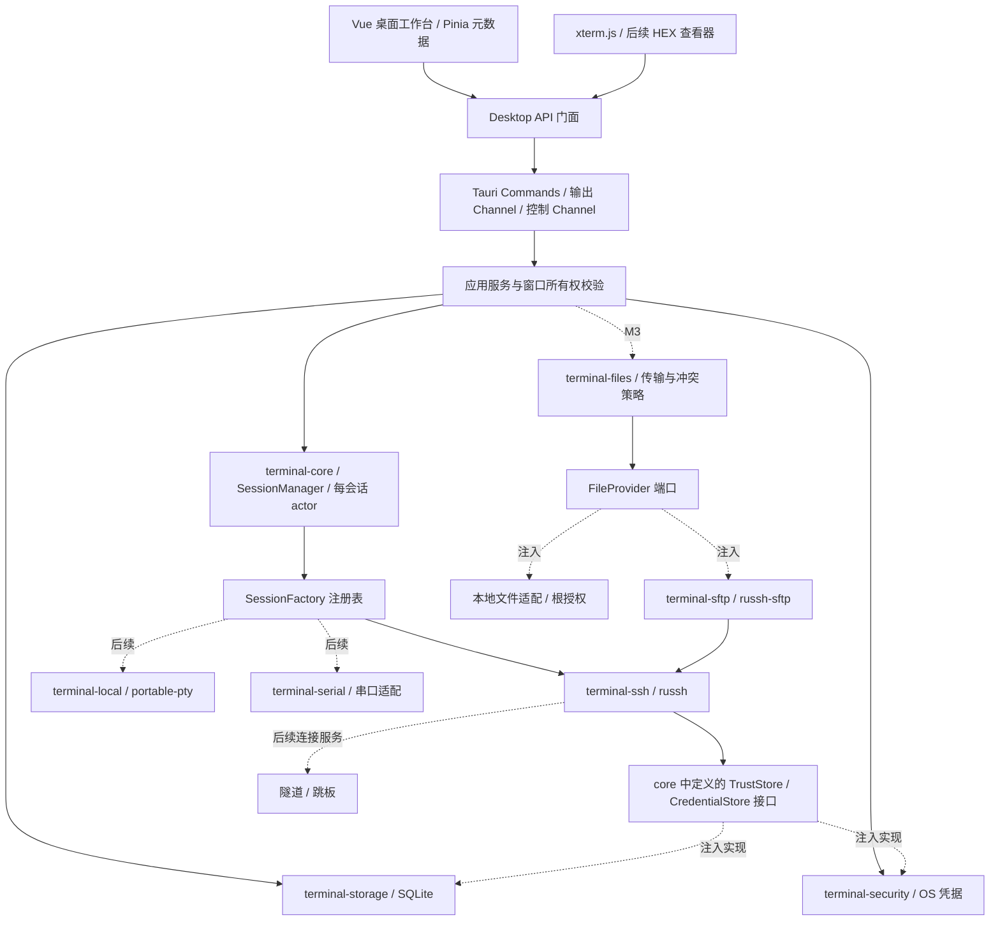

# 系统架构与模块边界

日期：2026-10-15。首期四个 crate 与桌面工作区已落源码；以下同时保留后续目标结构。实现待验证，实际差异见 [实施状态](17-implementation-status.md)。

## 1. 总体结构



图中的箭头表示调用关系；crate 编译依赖以第 3 节为准，不能让 core 编译依赖具体实现。

## 2. 关键分层

| 层 | 负责 | 不负责 |
| --- | --- | --- |
| 视图与交互 | 主机、标签、错误、信任与认证弹窗、终端焦点 | 网络连接、私钥解析、数据库 SQL |
| 前端服务 | 类型化 IPC、输入排队、帧解析、ACK、错误映射 | 存储密码或把字节塞入 Pinia |
| Tauri 适配/应用服务 | DTO 校验、窗口上下文、组装依赖、Channel、业务编排 | 实现 SSH 协议或持有全局协议大锁 |
| 通用会话 core | ID、状态、能力、actor 控制、限额、取消、输出事件 | Tauri 类型、WebView、russh/PTY 细节 |
| 传输适配器 | 具体协议连接、I/O、resize、专用控制、资源释放 | UI、任意 SQL、全局 UI event 广播 |
| 存储与安全 | 持久化、迁移、凭据库、数据脱敏 | 终端渲染、自动执行用户命令 |

首期一个主窗口；所有 session 绑定创建窗口。为未来多窗口保留 owner 标识，但不提前实现拖出标签或跨窗口转移。

凭据库分 password/privateKey，主机专属密码与公共凭据通过 owner_profile_id 隔离。安全服务协调 OS 秘密与 SQLite 引用的两阶段保存/清理；core 只定义不含序列化能力的 PrivateKeyMaterial 端口返回值。私钥导入后不依赖源文件，会话配置只含一种主要认证及凭据引用；主机公共 DTO 隐藏专属 ID，Rust 内部组装实际连接配置，临时连接只准用公共凭据。前端密码仅存在短期表单与 IPC 参数，不进入 Pinia 主机对象。

## 3. Rust 编译依赖

```text
src-tauri ──> terminal-core
          ├─> terminal-ssh ──────> terminal-core
          ├─> terminal-storage ─> terminal-core
          └─> terminal-security > terminal-core

后续 terminal-local / terminal-serial ──> terminal-core
M3 src-tauri ──> terminal-files（FileProvider / TransferManager / 冲突）
             └─> terminal-sftp ──> terminal-files + terminal-ssh
本地文件适配隔离于 terminal-files 平台模块，不依赖 portable-pty
后续 terminal-tunnel ──> terminal-ssh（受控连接服务 API）
```

core 的模型与端口允许使用 serde、bytes、Tokio 通道、async-trait 等基础库；不能依赖 Tauri、SQLx、russh、serialport、portable-pty。`CredentialStore`、`HostTrustStore` 等端口在 core 中定义；具体适配器实现。src-tauri 作为 composition root 注入，避免 SSH 与 storage/security 互相编译依赖。

采用每会话 actor 单独持有协议对象，manager 只保存轻量句柄。读取会话表的锁只用于查找、复制句柄，不跨 await。I/O 与流桥接分离，细节见 [会话模型](04-session-model.md)。

## 4. 目标目录（分阶段创建）

```text
termvexa/
├── AGENTS.md
├── docs/
├── src/
│   ├── app/                  # 应用壳、全局布局、样式 token
│   ├── components/           # 通用控件
│   ├── modules/
│   │   ├── hosts/            # 列表、分组、编辑器
│   │   ├── terminal/         # xterm 宿主、输入、搜索、流消费
│   │   ├── workspace/        # 标签、pane、布局；不持有网络资源
│   │   ├── credentials/      # 元数据、选择和删除，不提供秘密读取
│   │   ├── settings/          # 快捷键、终端配色与应用偏好
│   │   ├── files/             # M3 共享 FileBrowser、侧栏/双栏
│   │   └── transfers/         # M3 任务、进度、覆盖 challenge
│   ├── services/desktop/     # invoke/Channel 唯一入口
│   ├── services/commands/    # CommandRegistry、KeymapService、ShortcutRouter
│   ├── services/themes/      # TerminalThemeService；独立于应用 CSS 主题
│   ├── stores/               # Pinia 轻量状态
│   └── types/                # IPC DTO；与 Rust 契约同步
├── Cargo.toml                # 未来虚拟 workspace 根
├── crates/
│   ├── terminal-core/src/    # models, ports, manager, actor, errors
│   ├── terminal-ssh/src/     # factory, connection, auth, host_key, driver
│   ├── terminal-storage/
│   │   ├── src/              # repositories, migrations, backup
│   │   └── migrations/
│   └── terminal-security/    # 系统凭据适配和秘密类型
├── src-tauri/
│   ├── src/
│   │   ├── commands/         # session, host, trust, credentials, settings
│   │   ├── application/      # 用例服务与依赖装配
│   │   ├── ipc/              # DTO、二进制帧、流桥接
│   │   ├── state.rs
│   │   └── lib.rs
│   ├── permissions/
│   ├── capabilities/
│   └── Cargo.toml
└── package.json
```

首期创建 core/ssh，再随持久化与凭据任务创建 storage/security；M3 再创建 terminal-files/terminal-sftp，不创建只有占位内容的 local/serial/sftp crate。根 workspace 使用 resolver 3 配合 edition 2024 的候选方案；最终工具链版本待 SP 验证。workspace 落地时把现有 src-tauri/Cargo.toml 的 release profile 移到根，统一 Cargo.lock，核对 Tauri 相对路径与命令 hooks；本次不修改。

## 5. 前端与终端生命周期

当前 `WorkspaceStore.tabs` 仅保存终端元数据，`tabIds` 将固定 `home`、`sftp` 与 terminalId 组合为导航顺序；固定页不占用 SessionManager，`active` 在固定页为空。`homeSection` 管理主机/凭据/设置。`tabPosition` 只改变 CSS 布局，终端宿主始终挂载。后续完整工作区的 tab 采用版本化判别联合：terminal Tab 持有 pane/terminalId，M3 sftp Tab 持有左右 browserId/端点引用；SFTP Tab 不创建虚假 xterm。terminal Tab 可挂附属 fileBrowserId 与 dock 位置。`WorkspaceStore` 保存上述视图映射；`SessionStore` 保存每次后端连接尝试的状态、尺寸、错误和能力；`TerminalRegistry` 按稳定 terminalId 用普通 Map 管理 xterm 实例、当前 session 绑定、连接代次、订阅与输入队列，不深度响应式化。terminalId 在断线、失败和重连时保持不变，不能用后端 sessionId 作为终端 Vue 组件的 key。

建立连接前先创建 Tab、terminalId 与终端宿主并装好 Channel handlers，即使 open_session 同步失败也保留视图。握手期间展示状态，Connected 前关闭远端键盘写入，但保留滚动/选择/复制/搜索。切标签不卸载 xterm；隐藏终端继续解析和 ACK，只减少不必要的渲染与 resize。ResizeObserver 只对可见且非零尺寸的宿主调用 fit。

后端终态只回收连接及其订阅，不清空/销毁终端，也不移除 Tab；只有用户关闭 Tab/窗口才 dispose 视图。重连串行结束旧连接的数据排空，在原终端加入可信本地状态分界，再绑定新 session/Channel，继续追加到同一 xterm。旧 session 的 ACK、帧序号与 offset 不得延续到新连接，也不能让其迟到状态覆盖新状态；见 [IPC 规则](06-ipc-and-streaming.md)。

UI 使用 Naive UI 现成组件及 `src/components/ui/` 薄适配，NConfigProvider 管理主题，页面只保留必要布局。工作区与 xterm 宿主留在业务模块，独立于 NTabs/TabPane 显隐生命周期。系统原生菜单/文件选择继续由 Tauri 负责，详见 [UI 选型](13-ui-stack.md)。

## 6. 扩展接口

- `SessionKind`：首期 `ssh`；模型认可 `local`/`serial`，未注册的工厂返回 `UNSUPPORTED_SESSION_KIND`，UI 不展示可连接入口。
- `SessionFactory`：验证该 kind 的版本化配置，创建 driver；`available_session_kinds` 返回已注册工厂能力。
- `SessionCapabilities`：如 resize、PTY、binaryOutput、serialControl；通用 UI 根据能力启用，不根据 `kind === ssh` 推断。
- `SessionControl`：通用 Write/Resize；未来 SerialControl 为受类型约束的专用扩展，不提供 `executeAnything` 或任意 JSON 逃逸口。
- 输出恒为 bytes；终端/HEX 是两个消费视图。将来单 session 在二者切换要定义缓存与重放范围，不承诺无限历史。
- 配置使用版本化 discriminated union，DTO 映射到 core typed enum；不把 ssh 地址/用户名放进所有会话必填字段。

为防过度抽象，第一版只实现 SSH 分支，但使用 fake driver 检验管理器不引用 SSH 类型；Local/Serial 控制与配置以设计保留。

## 7. SSH connection 与 terminal session

M1/M2 默认一个 terminal session 拥有一个 SSH connection 和一个 Shell channel，关闭时一并回收。提前区分 connectionId 与 sessionId，但不做跨主机池化。

M3 引入受控 `SshConnectionService` 为 Shell/SFTP/隧道分配 channel 和租约；应用会话/文件浏览器/传输任务各自持有租约，最后一个租约释放后才关闭 connection。独立 SFTP 只打开 subsystem，不分配 PTY/Shell；认证 challenge 从 session-only 扩展为类型化资源归属，仍共用信任和凭据端口。共享需要实现公平调度、背压隔离、错误广播和“关闭终端但保留传输”的 UX；不得把 russh Handle 暴露给前端或通用 files crate。具体政策见 [SFTP 设计](16-sftp-workspace.md)。

FileProvider 是文件领域接口，不扩充 TerminalSession；TransferManager 负责两端读写、冲突/取消与有界中转。两种 SFTP 界面复用 files/transfers 服务，远端互传不经过 xterm/WebView、不默认落盘。原生拖出由壳的平台适配器负责，独立于网页内部拖拽。

## 8. 错误与观测

core 统一错误码与阶段，协议错误在适配器映射；应用层增加 requestId/sessionId，前端显示可操作文案。结构化日志只包含状态、耗时、受控端点摘要和队列统计；禁止派生 Debug 输出密码/私钥/认证 response。业务数据不与终端输出混用日志管道。

## 9. 快捷键与配色服务

CommandRegistry 统一菜单、按钮与按键动作，KeymapService 合并平台默认/用户覆盖，ShortcutRouter 按焦点/IME/模态上下文只消费一次。全局默认应用内前台，系统后台注册为可选适配；Cmd+L 的 Local 动作由工厂能力启用。详见 [快捷键](14-shortcuts.md)。

TerminalThemeService 解析全局/profile/当前终端方案优先级并转换 xterm ITheme；ThemeRepository 管持久化用户方案，应用 CSS tokens 单独管理 UI 明暗主题。颜色热应用到原 xterm，不 clear/reset/dispose；导入在后端按 schema 校验。详见 [终端配色](15-terminal-themes.md)。

## 首期落地边界（2026-10-15）

四个领域 crate、Tauri commands/state 与 Vue modules 已创建。当前只注入 SshFactory，不为未实现的 Local/Serial 构建空工厂；仍通过 SessionFactory trait 隔离协议。原生壳只做 DTO/owner/资源桥接，具体握手、认证、PTY 与 socket 取消在 terminal-ssh。SQLite 复合写使用 BEGIN IMMEDIATE，不在应用全局锁内等待数据库。

UI tokens 目前集中 `src/styles.css`，项目交互封装为 `src/components/ui/`；命令注册表在 `src/services/commands/`，只有 `src/services/desktop/` 能调用 invoke。终端注册表和设置/主机/工作区分模块维护；设置面板拆为配色、快捷键、安全子组件。未创建文件/传输/Local/Serial crate。实际交付与限制见 [实施状态](17-implementation-status.md)。
