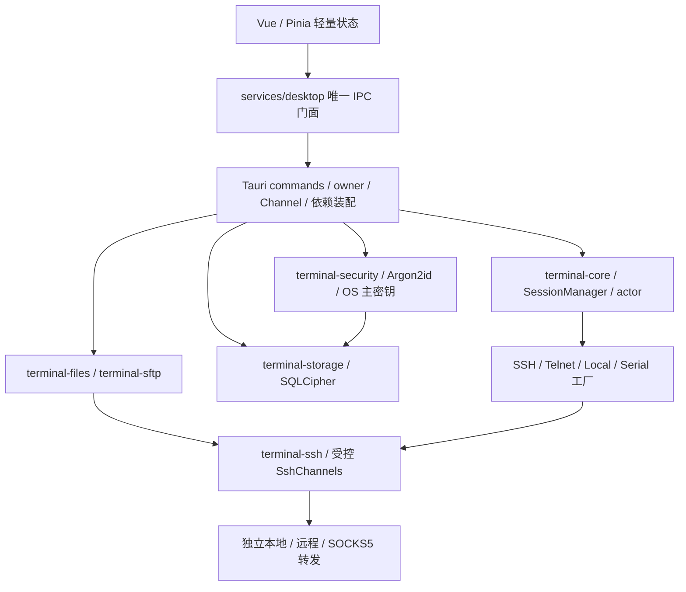

# 系统架构与模块边界

更新：2026-10-16。本文描述当前源码分层，后续能力明确标注。功能状态见 [产品需求](01-product-requirements.md#8-当前实现与限制)，运行集成尚未完整验收。

## 1. 总体结构



图为调用关系，编译依赖以第3节为准。所有网络、凭据、信任、数据库与设备访问由 Rust 管理。前端不持有 russh handle、数据库连接或保存的秘密。

## 2. 职责与目录

| 位置                                                | 当前职责                                                    |
| --------------------------------------------------- | ----------------------------------------------------------- |
| src/App.vue、src/layout                             | 根装配、稳定终端舞台、保险箱导航、应用外观                  |
| src/modules/hosts、credentials、history、forwarding | 保存项/分组/搜索、凭据元数据、信任/历史、转发规则及轻量状态 |
| src/modules/terminal、workspace                     | xterm 注册表、输入路由、标签组、布局树、广播、工作区存档    |
| src/modules/settings                                | 独立 SettingsWindow、表单/预览、自动保存与跨窗口同步        |
| src/modules/files                                   | 单终端 SFTP 侧栏、双远端工作区、轻量队列与目录展示          |
| src/services/desktop                                | 类型化 invoke/Channel，唯一 IPC 门面                        |
| src/services/commands                               | 命令注册、快捷键、焦点/模态路由                             |
| src-tauri/src/commands                              | DTO、窗口/资源授权、用例编排和 Channel 桥                   |
| src-tauri/src/files                                 | 浏览器获取、上传/下载编排、原生授权目标处理                 |
| crates/terminal-core                                | 模型、端口、能力、actor、限额、取消、字节队列和 ACK         |
| crates/terminal-ssh                                 | russh、信任/认证、PTY、SFTP channel 服务、系统识别与转发    |
| crates/terminal-telnet、local、serial               | TCP 协商、本地 PTY、设备独占与字符集转换                    |
| crates/terminal-storage、security                   | SQLCipher/迁移、元数据/凭据事务、主密钥派生/缓存与解锁      |
| crates/terminal-files、sftp                         | 文件 DTO/provider/有界复制，SFTP browser/remote_file/copy   |

根 workspace 使用 resolver 3、edition 2024、共享 release profile 和 Cargo.lock。前端使用 Vue Composition API、严格 TypeScript 与 pnpm。没有独立 transfers 或 terminal-tunnel crate；通用连接租约和完整 TransferManager 仍待实现。

## 3. Rust 编译依赖

```text
src-tauri -> core / ssh / telnet / local / serial / storage / security / files / sftp
ssh / telnet / local / serial / storage -> core
security -> core + storage
sftp -> core + files + ssh
```

core 可使用 serde/bytes/Tokio/async-trait 等基础库，不依赖 Tauri、SQLx、russh、serialport 或 portable-pty。CredentialStore、HostTrustStore、RemoteSystemStore 等端口由具体适配器实现，壳注入。security 依赖 storage 是现行事务协调关系，不假定凭据仓库已完全反转依赖。

## 4. 会话与受界数据流

每会话 actor 持有驱动，manager 只保存轻量句柄；表锁只用于查询/复制句柄，不跨 await。SessionConfig 当前包含 Ssh/Telnet/Local/Serial，以及专用 Forwarding；协议配置不强制共用 SSH 地址/认证字段。

壳分别持有 sessions、file_sessions、forward_sessions 三个 SessionManager。终端 manager 注册四种终端工厂；文件/转发使用 for_files/for_forwarding 专用 SSH 工厂，复用信任/认证与取消，无 PTY/Shell。挑战响应、快照与关闭按 owner/sessionId 路由到所属 manager。每个 manager 的限额独立，不能据此宣称合计容量已验证。

输出为二进制 Channel，控制为类型化 Channel，解析后累计 ACK 施加背压；独立取消不被 ACK 堵塞。Serial 文本输出在适配器转为 UTF-8，偏移统计转换后字节；Telnet 剥离 IAC 并处理 NVT/BINARY。未来 HEX 需另定义原始字节通道。详见 [会话](04-session-model.md) 与 [IPC](06-ipc-and-streaming.md)。

## 5. 稳定终端与工作区

WorkspaceStore.tabs 保存终端元数据，groups 保存标签顺序/布局/聚焦/广播；activeId 指固定页或组，active 指聚焦终端。固定 home/sftp 不创建 xterm。TerminalRegistry 用普通 Map 按 terminalId 保存实例、当前 session/代次、订阅与输入队列。

打开连接前创建 terminalId、宿主和 Channel handlers；即使命令失败也保留视图。TerminalStage 在同一层按 terminalId keyed 渲染宿主，布局树只计算矩形，排序、分屏、比例/交换、迁移与切页不重建实例。隐藏终端继续解析/ACK，只减少渲染/resize。

后端终态只释放连接和订阅，保留 Tab/xterm/历史；用户关闭视图才 dispose。重连结束旧流、追加本地状态分界，再绑定新 session，旧帧/ACK/状态不能污染新连接。

运行布局与 SavedWorkspace 存档分离；存档只含布局/焦点和保存连接 ID，由 storage/workspaces 事务校验名称、引用与 revision。打开生成全新终端/节点/会话，广播关闭。详见 [工作区](18-terminal-workspaces.md)。

广播仅前端内存状态。inputOrigin 薄适配固定 xterm 6 用户输入事件，inputRouter 排除自动应答/鼠标点击，registry 向各目标独立 FIFO 分发；不调用目标 term.input 触发递归。成员重组关闭广播，排序/比例/区域交换保持。无专用广播 IPC 或持久化。

## 6. 保存项、保险库与设置

保存项共用 connection_profiles 和轻量分组/收藏元数据，SSH/Telnet/Serial 各自校验参数；workspace 不是可由 open_session 直接打开的协议类型。saved/profileId 始终由 Rust 重读并分派工厂，前端 kind 仅展示能力。

VaultGate 完成首次设置、OS 自动解锁或密码恢复后挂载业务页面。只有 vault_status/unlock_vault 是锁定时可用的业务入口；窗口操作保留。storage 发布已解锁 SQLCipher 池前完成迁移/外键检查；OS 仅缓存主密钥，秘密仅 Rust 加载。当前 schema 6 和升级边界见 [存储](07-storage.md)。

设置独立单实例窗口由 settings_window.rs 与 SettingsWindow.vue 装配，入口不挂载 App/终端/工作区心跳。useLiveSettings 校验/自动保存，useSettingsSync 跨窗口同步；Rust 设置专用队列合并最新局部字段。settings_owner 仅向 main/settings 开放设置/JSON 导出，通用 owner 仍仅 main。

## 7. SSH、SFTP 与转发

一个普通 SSH terminal session 拥有连接和 Shell channel；侧栏经 owner-bound SshChannels 申请独立 SFTP 子系统，但生命周期随终端。Shell 结束关闭传输，不支持关闭标签后后台继续。固定双栏各有文件专用连接、浏览器和分页，切页保活，不运行终端或系统识别。

FileProvider 属于文件领域，通用 TerminalSession 不添加 listFiles/startTunnel。壳负责原生文件选择、授权和任务编排；terminal-sftp 提供浏览、文件 I/O、对拷。双远端复制以64 KiB有界中转同时占用两端操作锁和一个全局传输许可，正文不进 WebView/临时落盘。共享连接租约、持久任务及本地文件 provider 仍是后续范围。

file_drag.rs 管理短期 owner-bound 原生拖入引用；file_drag_macos.rs 管理 AppKit 文件承诺/手势；commands/file_drag.rs 负责授权和下载回调。Web Pointer Events 只处理内部对拷与工作区布局。完整契约见 [SFTP](16-sftp-workspace.md)。

端口转发在 terminal-ssh/forwarding 与 socks 实现，独立 forward_sessions 不借用终端或文件连接。规则存 storage/forwarding，命令管理启停/权限，前端仅轻量状态。见 [端口转发](21-port-forwarding.md)。

保存 SSH 终端 PTY/Shell 打开后才并行触发系统识别，RemoteSystemStore 事务 claim 一次机会，固定资源命令独立 exec，不写 PTY/广播，结果仅持久化图标/标记。详见 [SSH](05-ssh-design.md#10-一次性主机系统识别)。

## 8. UI、命令与静态约束

Naive UI 提供通用控件，业务 CSS 属于对应 Vue scoped 样式；两个入口共用 assets/base.css，字体 CSS 独立。表单 model 与 v-model/path 共享响应式字段，不能在渲染时复制校验快照。详见 [UI](13-ui-stack.md)。

CommandRegistry 统一按钮/菜单/快捷键。KeymapService/TerminalThemeService 是设计职责名，不表示存在同名类：配色优先级在 terminal/registry.ts，转换在 settings/themes.ts，选区薄适配在 terminal/theme.ts；应用主题由 layout/useAppAppearance 管理。

scripts/check-structure.mjs 仅读取源码/清单，检查边界和常见表单误用；不是编译或运行测试。错误统一映射为阶段/代码，日志不得输出密码、私钥、认证答案、终端/文件正文。权限边界见 [安全设计](08-security.md)。
