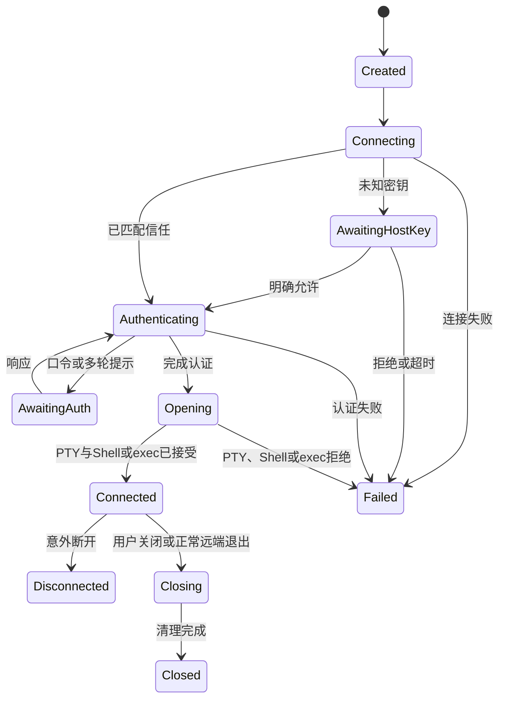

# 统一会话模型与生命周期

更新：2026-10-16。core 会话管理、流控与四类终端驱动已实现；局部 core/Serial 测试有历史执行证据，当前完整集成尚待验收。源码与实际差异见 [需求与实现状态](01-product-requirements.md#8-当前实现与限制)。

## 1. 概念与标识

- HostId/ProfileId：保存的连接配置，不随每次打开改变。
- TerminalId：前端终端视图 UUID，由工作区创建；拥有 Tab 内的 xterm 实例和有限滚屏缓冲，跨断线/失败/重连保持不变。
- SessionId：后端一次连接尝试生命周期的 UUID，由后端生成；重连创建新 ID，绑定回原 TerminalId；后端终态不结束前端终端生命周期。
- Connection：底层 SSH 传输，当前由各会话工厂持有；没有独立公开 ConnectionId 或共享租约接口。
- RequestId：前端创建的打开请求幂等标识；同一窗口同一 ID 不得建立两条连接。
- ChallengeId：一次信任或认证交互，只在绑定 session/阶段/期限内有效。
- Owner：创建窗口/WebView 身份，由 Tauri 注入，不采信前端传入的字符串。

## 2. 状态机



图省略公共边：所有非终态均可因显式取消进入 Closing；AwaitingAuth 超时/失败进入 Failed；已连接协议异常可进入 Disconnected。Failed、Disconnected、Closed 都要求协议资源最终释放，不是留下后台连接的“暂停态”。前端 Tab、xterm 和缓冲必须保留并允许滚动/复制/搜索；manager 中资源句柄须移除，仅保留有界短期 tombstone 支持幂等关闭。后端 tombstone 过期不能触发前端历史清理。

正常远端 exit 记录 exit code/signal，走 Closing→Closed；网络/KeepAlive 丢失走 Disconnected；建立阶段错误走 Failed。不把“用户关闭”“命令正常退出”和“网络失败”显示成同一个错误。

SSH 配置的 startup 区分交互 Shell 与 PTY exec，共用生命周期、输出/ACK及取消路径。SessionSnapshot.sshCommand 由本次后端配置确定；命令模式连接期间始终视为运行中，正常退出保留终端并显示退出码/信号。显式重新运行创建新 session 并再执行一次配置命令，不重放旧输入，也不在网络失败后自动重新执行。详见 [SSH](05-ssh-design.md)。

## 3. 当前核心接口

工厂接口来自 core/ports.rs：

```rust
#[async_trait::async_trait]
pub trait SessionFactory: Send + Sync {
    fn kind(&self) -> &'static str;
    fn capabilities(&self) -> SessionCapabilities;
    fn validate(&self, config: &SessionConfig) -> Result<()>;
    async fn run(&self, config: SessionConfig, context: DriverContext) -> Result<SessionEnd>;
}
```

SessionManager 以 Arc<dyn SessionFactory> 注册并选择工厂，直接运行其 run；没有独立 SessionDriver/SessionHandle/SessionControl 公共接口。manager 提供 write/resize/ack/close 等入口，不向外暴露底层协议对象。

DriverContext 包含 owner、初始 size、独立 cancel、mpsc 输入接收器、watch 尺寸接收器、OutputSender、SessionEvents 和 ChallengeBroker。InputChunk 持有字节预算许可，resize 只保留最新值；取消和挑战响应不挤入可能被写入塞满的同一队列。信任/凭据等端口由具体工厂持有，core 不读取数据库或钥匙串。

## 4. 任务拓扑与公平性

1. Manager 负责注册表、配额、幂等、查询、取消和终态快照。
2. Driver actor 持有连接/Shell，处理读、写、resize、协议状态；认证期间不接收普通写入。
3. 输出 forwarder 从有界原始字节队列取数据，在信用足够时通过 Tauri Channel 发送；不占 actor 的控制路径。
4. SessionEvents 通过 SessionSink 发布状态/challenge；控制消息与输出信用独立，发送失败取消会话，挑战有数量/长度/期限限制。

SSH 库内部连接处理任务持续驱动 KeepAlive/协议；应用输出慢不应同步堵住所有控制。应用 pending 输出满时暂停取 Shell 数据，继续接受取消/关闭；需要通过 SP-05 验证 russh 内部窗口/队列边界是否允许该行为。不能在单 select 分支里无限等待 `output.send().await` 或远端 write 而饿死其他分支。

输入按序单 writer；写请求的耗时等待可取消，超时视为交付状态不确定，不能自动重发。读写大流量时每轮处理有限批次并让出执行权。resize 合并为最新值，close 优先于未处理输入。

## 5. 生命周期契约

### 打开

`open_session` 先做 DTO/所有权/配额检查并分配句柄，创建 Created 快照并启动异步连接任务，命令返回该快照。输出与控制 Channel 必须在调用前就有 handler；事件可能早于命令 Promise 返回，因此前端按 requestId 建临时记录，再按 sessionId 归并。

同一 requestId 重试返回同一个快照且不创建第二条连接；不替换已绑定的 Channel。终态重试在有界幂等缓存期限内返回终态快照；缓存过期要求新 requestId。格式非法等同步错误不创建 session。

活动 requestId 的绑定保留到会话终止，不因普通 TTL 过期而允许重复建连。终态快照与 requestId/tombstone 初始保留 10 分钟、每个 SessionManager 最多 1024 条，达到上限先淘汰最旧终态；淘汰后查找/关闭可返回 NOT_FOUND，UI 不把它解释成仍然在线。配置快照等大对象不放入 tombstone。

### 关闭/取消

本节 close 指后端连接的关闭；UI 的“断开”调用 close_session 但保留终端，“关闭 Tab”才额外释放视图。连接失败、拒绝信任、认证取消及正常远端退出都不自动执行“关闭 Tab”。

close 在任意阶段幂等；立即设置取消信号并拒绝新输入，撤销所有 challenge。按适配器规则释放 channel/connection/worker，等待有期限；SSH 必要时放弃优雅关闭并释放底层 transport。输出 forwarder 的信用等待也被取消，close 不等待前端 ACK 才能回收网络资源。

默认资源清理预算 3 秒（待验证）。返回 close 请求已受理与最终 Closed 是不同事件；`close_session` 返回当前快照，前端等待终态事件或查询确认。重复关闭同一 owner 的 tombstone 返回成功；未知 ID 返回 NOT_FOUND；其他 owner 永远 FORBIDDEN。

正常 EOF 可以在资源回收后有期限地排空已接收输出，再发布最终事件。显式关闭/崩溃导致放弃尾部输出时，记录 `outputComplete=false`，不伪称完整捕获。最终事件带 finalOffset，用于处理两个 Channel 的交错。

`finalOffset` 指 forwarder 停止发送后，最后一帧**成功提交到输出 Channel**的 endOffset；不是尚未发送的接收总量。协调器先停止/汇合 forwarder、冻结 offset，再发 ended；此后不能再发送新帧。outputComplete=true 表示驱动已接收的全部 payload 都已提交，解析完成仍以消费者 ACK 为准；未发出的尾部被丢弃则为 false。

### 同终端重连

工作区以稳定 terminalId 保有 xterm。重连创建新的 requestId/sessionId 与 Channel，仅替换连接绑定，不调用 xterm.clear/reset/dispose、不重建宿主、不清空历史。旧输入队列清空以避免重放；旧输出按有期限排空流程完成后才接入新流。重复点击重连必须 single-flight，旧状态回调按 sessionId + 绑定代次隔离。重连再次失败仍保留 Tab、原终端缓冲与错误信息，可继续滚动/复制/搜索并再次尝试。

### 退出与崩溃

主窗口确认退出后集中取消所属会话，有期限汇合后台任务。WebView 重载/崩溃不承诺恢复原 stream：使用窗口生命周期信号与控制面心跳共同发现失联，超出宽限后关闭；不因标签隐藏就关闭。应用进程崩溃依靠 OS 释放 socket，未来本地进程树需要独立处理。

## 6. 能力与扩展

| 能力           | SSH      | Local（基础） | Serial（文本）                   | Telnet                             |
| -------------- | -------- | ------------- | -------------------------------- | ---------------------------------- |
| 输入/输出      | 原始字节 | 原始字节      | 流式字符集转 UTF-8，非法序列替换 | 剥离 IAC、处理 NVT/BINARY 后的字节 |
| resize         | 是       | 是            | 否                               | NAWS 协商后通知                    |
| PTY            | 是       | 是            | 否                               | 否                                 |
| 远端主机信任   | 是       | 否            | 否                               | 否                                 |
| 会话内串口控制 | 否       | 否            | 未实现，启动参数可配置           | 否                                 |
| HEX 视图       | 未实现   | 未实现        | 未实现，需独立原始通道           | 未实现                             |

不要把 resize 无操作成功当成所有协议都实现了 PTY；调用方根据 capabilities 显示支持情况。

## 7. 错误模型

SessionError 包含 `code`、`phase`、`retryable`、`message`，关联 ID 由命令/SessionEvent 信封携带，不额外序列化 details 或原始错误。错误码按实际适配器定义；常见类型包括 INVALID_CONFIG、UNSUPPORTED_SESSION_KIND、UNSUPPORTED_OPERATION、FORBIDDEN、LIMIT_EXCEEDED、DNS_FAILED、CONNECT_TIMEOUT、HANDSHAKE_FAILED、HOST_KEY_UNKNOWN、HOST_KEY_CHANGED、AUTH_FAILED、AUTH_TIMEOUT、PTY_REJECTED、SHELL_REJECTED、EXEC_REJECTED、IO_FAILED、INPUT_DELIVERY_UNKNOWN、CONSUMER_STALLED、CANCELLED、STORAGE_FAILED、CREDENTIAL_STORE_UNAVAILABLE、PROTOCOL_MISMATCH。

retryable 只表示用户可以重新尝试连接，不表示允许自动重放 write。不能把原始 Error/Debug 直接序列化给前端。

## 8. 源码映射与验证

[types](../crates/terminal-core/src/types.rs) 定义状态/配置/事件，[ports](../crates/terminal-core/src/ports.rs) 定义工厂/信任/凭据/消费端，[manager](../crates/terminal-core/src/manager.rs) 管理 owner/幂等/配额与任务，[session](../crates/terminal-core/src/session.rs) 管理 challenge/状态，[stream](../crates/terminal-core/src/stream.rs) 管理字节预算与 ACK。Local/Serial工厂已注册；不宣称目标抽象全部实例化。core 部分测试在历史串口授权调试中执行；这不覆盖最新全部会话集成，取消/信用耗尽/终态跨 Channel 次序仍需验收。

## 9. 工作区与会话身份

M2 内存分屏不改变 actor 或 session 模型：标签组ID、terminalId、后端sessionId各自独立；一个组可含多个稳定terminalId，各自保有独立会话/队列/历史。排序/合并只改前端树，断线保留原窗格；重连仅更换该叶子后端sessionId。全局终端动作以聚焦叶子为目标，关闭标签协调所有叶子，关闭单窗格仅回收自身。详见 [终端工作区](18-terminal-workspaces.md)。

工作区广播：工作区广播是前端输入分发，不创建共享actor或合并会话队列；每目标独立inputSeq、字节限额与stream代次，断线不补发、不自动重放。多行确认期间保存组广播版本及目标代次，失效不转交给新连接；开启广播不影响输出/ACK/KeepAlive/取消。

## 本地驱动

SessionFactory 接收 SessionConfig（含 Ssh/Telnet/Local/Serial 与专用 Forwarding），SessionManager::open 兼容 SshConfig 的 Into 转换；with_factory 注册本地工厂，共享20个活动会话限额与连接额度。Local 使用独立阻塞读写线程、有界4×32KiB读取桥和单块输入桥，InputChunk 保留字节预算许可；输出泵与resize/退出轮询并行，取消丢弃驱动时终止子进程并异步回收。PTY创建放在阻塞任务内，晚到的创建结果同样由RAII清理。Unix 初始进程组强制结束；已脱离组的子进程、Windows完整进程树仍待完善。Shell退出后等待PTY输出排空，再由核心发布Ended并保留前端历史。

后续 LocalConfig 的 cwd/argv 扩展及 Windows inbound 生命周期计划见[系统终端集成方案](24-terminal-system-integration-plan.md)，均未实现；inbound 接纳已有 client，不能通过重执行命令模拟。启动偏好不改变当前 SessionConfig/门禁或工作区存档范围。

## 串口驱动

SessionConfig增加SerialConfig，SerialFactory接入共用会话表；不支持PTY/远端resize/会话内专用控制。独占设备由读写线程持有，应用内登记在最后句柄关闭后释放；future取消同样触发线程取消。读取桥4×8KiB与单块输入桥均有界，输出转码/ACK等待不阻止取消；错误停止设备并排空已读输出，用户取消仍优先。所有输出字符集（含 UTF-8）均流式解码，非法序列显示替换字符；UTF-8 输入原样传递，其他输入字符集跨块转换；Channel偏移针对转换后字节。详细契约和真实设备验证边界见[Serial设计](19-serial-terminal.md)。

## Telnet适配

SessionConfig增加Telnet(TelnetConfig)，kind=telnet，能力为resize=true/pty=false/binaryOutput=true/serialControl=false。状态从Connecting直接进入Connected，表示TCP建立；Telnet没有SSH认证挑战，远端登录与密码隐藏由服务端终端交互控制。协议适配器维护IAC/选项/子协商状态，NAWS同意前仅保存最新尺寸。DNS/TCP和单次socket写入各30秒截止，有界队列与独立取消沿用core；正常EOF为Closed、I/O错误为Disconnected，失败/断线均保留原xterm，重连创建新session。详见[Telnet设计](20-telnet-terminal.md)，协议/服务兼容性尚未运行验收。

## 独立文件与转发会话

壳的 file_sessions 和 forward_sessions 分别使用专用 SSH 工厂，复用 core 状态/挑战/取消但不启动终端或数据视图。Forwarding 配置含 SSH 目标与 ForwardRule，三种模式监听就绪才 Connected；文件会话提供 SFTP channel。它们不注册终端历史，权限与生命周期分别见 [SFTP](16-sftp-workspace.md) 和 [端口转发](21-port-forwarding.md)。
