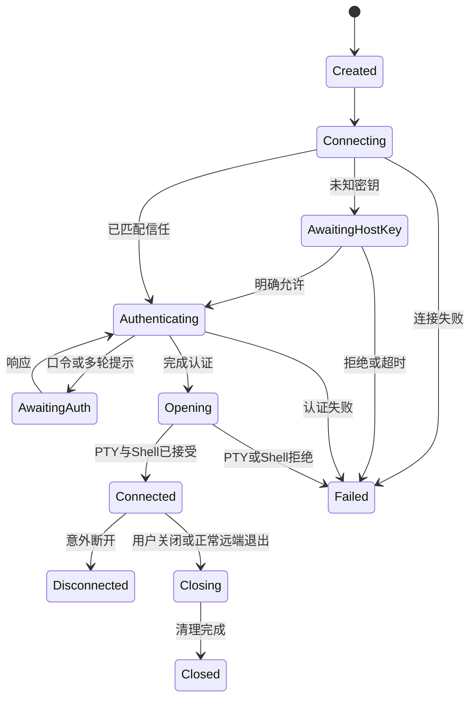

# 统一会话模型与生命周期

日期：2026-10-15。core 会话管理、流控与 SSH 驱动已实现待验证；领域测试仅编写未运行。源码与实际差异见 [需求与实现状态](01-product-requirements.md#8-当前实现与限制)。

## 1. 概念与标识

- HostId/ProfileId：保存的连接配置，不随每次打开改变。
- TerminalId：前端终端视图 UUID，由工作区创建；拥有 Tab 内的 xterm 实例和有限滚屏缓冲，跨断线/失败/重连保持不变。
- SessionId：后端一次连接尝试生命周期的 UUID，由后端生成；重连创建新 ID，绑定回原 TerminalId；后端终态不结束前端终端生命周期。
- ConnectionId：底层 SSH 传输身份，首期与 session 一对一但不可混用。
- RequestId：前端创建的打开请求幂等标识；同一窗口同一 ID 不得建立两条连接。
- ChallengeId：一次信任或认证交互，只在绑定 session/阶段/期限内有效。
- Owner：创建窗口/WebView 身份，由 Tauri 注入，不采信前端传入的字符串。

## 2. 状态机



图省略公共边：所有非终态均可因显式取消进入 Closing；AwaitingAuth 超时/失败进入 Failed；已连接协议异常可进入 Disconnected。Failed、Disconnected、Closed 都要求协议资源最终释放，不是留下后台连接的“暂停态”。前端 Tab、xterm 和缓冲必须保留并允许滚动/复制/搜索；manager 中资源句柄须移除，仅保留有界短期 tombstone 支持幂等关闭。后端 tombstone 过期不能触发前端历史清理。

正常远端 exit 记录 exit code/signal，走 Closing→Closed；网络/KeepAlive 丢失走 Disconnected；建立阶段错误走 Failed。不把“用户关闭”“命令正常退出”和“网络失败”显示成同一个错误。

## 3. 接口草案

下面是 core 设计示意，类型需在实现时补全；不直接照抄为可编译代码。

```rust
#[async_trait::async_trait]
pub trait SessionFactory: Send + Sync {
    fn kind(&self) -> SessionKind;
    fn capabilities(&self) -> SessionCapabilities;
    fn validate(&self, config: &SessionConfig) -> Result<(), SessionError>;
    async fn create(&self, config: SessionConfig)
        -> Result<Box<dyn SessionDriver>, SessionError>;
}

#[async_trait::async_trait]
pub trait SessionDriver: Send {
    async fn run(self: Box<Self>, context: DriverContext)
        -> Result<SessionEnd, SessionError>;
}

pub enum SessionControl {
    Write { seq: u32, data: bytes::Bytes, reply: WriteReply },
    Resize { size: TerminalSize, reply: ControlReply },
    // 未来按版本扩展受类型约束的 SerialControl，不加入任意执行入口。
}
```

采用 async-trait 是为了对象安全地装入 `Box<dyn ...>`；不能假设原生 async fn trait 可直接 dyn 分发。Driver 只要求 Send，由单任务拥有，不要求底层 PTY/协议对象都 Sync。对外 `SessionHandle` 提供 write/resize/close 等异步方法，发送 actor 消息，不把协议对象放进 `Arc<Mutex<dyn TerminalSession>>`。

`DriverContext` 包含 session/owner 元数据、control receiver、cancel token、受界输出 sink、独立控制事件 sink、challenge broker 和注入的端口。CancellationToken 与挑战响应不挤入可能被写入塞满的同一个队列。

## 4. 任务拓扑与公平性

1. Manager 负责注册表、配额、幂等、查询、取消和终态快照。
2. Driver actor 持有连接/Shell，处理读、写、resize、协议状态；认证期间不接收普通写入。
3. 输出 forwarder 从有界原始字节队列取数据，在信用足够时通过 Tauri Channel 发送；不占 actor 的控制路径。
4. 独立控制桥转发状态/challenge，容量也有界；状态可合并，challenge 不可丢，消费者消失要取消。

SSH 库内部连接处理任务持续驱动 KeepAlive/协议；应用输出慢不应同步堵住所有控制。应用 pending 输出满时暂停取 Shell 数据，继续接受取消/关闭；需要通过 SP-05 验证 russh 内部窗口/队列边界是否允许该行为。不能在单 select 分支里无限等待 `output.send().await` 或远端 write 而饿死其他分支。

输入按序单 writer；写请求的耗时等待可取消，超时视为交付状态不确定，不能自动重发。读写大流量时每轮处理有限批次并让出执行权。resize 合并为最新值，close 优先于未处理输入。

## 5. 生命周期契约

### 打开

`open_session` 先做 DTO/所有权/配额检查并分配句柄，返回 Created 快照后启动异步连接任务。输出与控制 Channel 必须在调用前就有 handler；事件可能早于命令 Promise 返回，因此前端按 requestId 建临时记录，再按 sessionId 归并。

同一 requestId 重试返回同一个快照且不创建第二条连接；不替换已绑定的 Channel。终态重试在有界幂等缓存期限内返回终态快照；缓存过期要求新 requestId。格式非法等同步错误不创建 session。

活动 requestId 的绑定保留到会话终止，不因普通 TTL 过期而允许重复建连。终态快照与 requestId/tombstone 初始保留 10 分钟、全局最多 1024 条，达到上限先淘汰最旧终态；淘汰后查找/关闭可返回 NOT_FOUND，UI 不把它解释成仍然在线。配置快照等大对象不放入 tombstone。

### 关闭/取消

本节 close 指后端连接的关闭；UI 的“断开”调用 close_session 但保留终端，“关闭 Tab”才额外释放视图。连接失败、拒绝信任、认证取消及正常远端退出都不自动执行“关闭 Tab”。

close 在任意阶段幂等；立即设置取消信号并拒绝新输入，撤销所有 challenge。按适配器规则释放 channel/connection/worker，等待有期限；SSH 必要时放弃优雅关闭并释放底层 transport。输出 forwarder 的信用等待也被取消，close 不等待前端 ACK 才能回收网络资源。

默认资源清理预算 3 秒（待验证）。返回 close 请求已受理与最终 Closed 是不同事件；`close_session` 返回当前快照，前端等待终态事件或查询确认。重复关闭同一 owner 的 tombstone 返回成功；未知 ID 返回 NOT_FOUND；其他 owner 永远 FORBIDDEN。

正常 EOF 可以在资源回收后有期限地排空已接收输出，再发布最终事件。显式关闭/崩溃导致放弃尾部输出时，记录 `outputComplete=false`，不伪称完整捕获。最终事件带 finalOffset，用于处理两个 Channel 的交错。

`finalOffset` 指 forwarder 停止发送后，最后一帧**成功提交到输出 Channel**的 endOffset；不是尚未发送的接收总量。协调器先停止/汇合 forwarder、冻结 offset，再发 ended；此后不能再发送新帧。outputComplete=true 表示驱动已接收的全部 payload 都已提交，解析完成仍以消费者 ACK 为准；未发出的尾部被丢弃则为 false。

### 同终端重连

工作区以稳定 terminalId 保有 xterm。重连创建新的 requestId/sessionId 与 Channel，仅替换连接绑定，不调用 xterm.clear/reset/dispose、不重建宿主、不清空历史。旧输入队列清空以避免重放；旧输出按有期限排空流程完成后才接入新流。重复点击重连必须 single-flight，旧状态回调按 sessionId + 绑定代次隔离。重连再次失败仍保留 Tab、原终端缓冲与错误信息，可继续滚动/复制/搜索并再次尝试。

### 退出与崩溃

主窗口确认退出后集中取消所属会话，有期限汇合后台任务。WebView 重载/崩溃不承诺恢复原 stream：使用窗口生命周期信号与控制面心跳共同发现失联，超出宽限后关闭；不因标签隐藏就关闭。应用进程崩溃依靠 OS 释放 socket，未来本地进程树需要独立处理。

## 6. 能力与扩展

| 能力                  | SSH        | Local（基础） | Serial（文本）                 |
| --------------------- | ---------- | ------------- | ------------------------------ |
| raw byte output/input | 是         | 是            | 是                             |
| resize                | 是         | 是            | 否，返回 UNSUPPORTED_OPERATION |
| PTY                   | 是         | 是            | 否                             |
| remote host trust     | 是         | 否            | 否                             |
| serial control        | 否         | 否            | 待实现；启动参数已支持 |
| HEX viewer            | 后续可扩展 | 后续可扩展    | 主要场景                       |

不要把 resize 无操作成功当成所有协议都实现了 PTY；调用方根据 capabilities 显示支持情况。

## 7. 错误模型

统一 `code`、`phase`、`retryable`、`requestId`、`sessionId`、脱敏 details。建议码：INVALID_CONFIG、UNSUPPORTED_SESSION_KIND、UNSUPPORTED_OPERATION、FORBIDDEN、LIMIT_EXCEEDED、DNS_FAILED、CONNECT_TIMEOUT、HANDSHAKE_FAILED、HOST_KEY_UNKNOWN、HOST_KEY_CHANGED、AUTH_FAILED、AUTH_TIMEOUT、PTY_REJECTED、SHELL_REJECTED、IO_FAILED、INPUT_DELIVERY_UNKNOWN、CONSUMER_STALLED、CANCELLED、STORAGE_FAILED、CREDENTIAL_STORE_UNAVAILABLE、PROTOCOL_MISMATCH。

retryable 只表示用户可以重新尝试连接，不表示允许自动重放 write。不能把原始 Error/Debug 直接序列化给前端。

## 8. 源码映射与验证

[types](../crates/terminal-core/src/types.rs) 定义状态/配置/事件，[ports](../crates/terminal-core/src/ports.rs) 定义工厂/信任/凭据/消费端，[manager](../crates/terminal-core/src/manager.rs) 管理 owner/幂等/配额与任务，[session](../crates/terminal-core/src/session.rs) 管理 challenge/状态，[stream](../crates/terminal-core/src/stream.rs) 管理字节预算与 ACK。Local/Serial工厂已注册；不宣称目标抽象全部实例化。fake driver 测试已编写，未执行；取消/信用耗尽/终态跨 Channel 次序仍需授权验收。

## 9. 工作区与会话身份

M2 内存分屏不改变 actor 或 session 模型：标签组ID、terminalId、后端sessionId各自独立；一个组可含多个稳定terminalId，各自保有独立会话/队列/历史。排序/合并只改前端树，断线保留原窗格；重连仅更换该叶子后端sessionId。全局终端动作以聚焦叶子为目标，关闭标签协调所有叶子，关闭单窗格仅回收自身。详见 [终端工作区](18-terminal-workspaces.md)。

工作区广播：工作区广播是前端输入分发，不创建共享actor或合并会话队列；每目标独立inputSeq、字节限额与stream代次，断线不补发、不自动重放。多行确认期间保存组广播版本及目标代次，失效不转交给新连接；开启广播不影响输出/ACK/KeepAlive/取消。

## 本地驱动（2026-10-16）

SessionFactory 接收 SessionConfig（Ssh/Telnet/Local/Serial），SessionManager::open 兼容 SshConfig 的 Into 转换；with_factory 注册本地工厂，共享20个活动会话限额与连接额度。Local 使用独立阻塞读写线程、有界4×32KiB读取桥和单块输入桥，InputChunk 保留字节预算许可；输出泵与resize/退出轮询并行，取消丢弃驱动时终止子进程并异步回收。PTY创建放在阻塞任务内，晚到的创建结果同样由RAII清理。Unix 初始进程组强制结束；已脱离组的子进程、Windows完整进程树仍待完善。Shell退出后等待PTY输出排空，再由核心发布Ended并保留前端历史。

## 串口驱动（2026-10-16）

SessionConfig增加SerialConfig，SerialFactory接入共用会话表；不支持PTY/远端resize/会话内专用控制。独占设备由读写线程持有，应用内登记在最后句柄关闭后释放；future取消同样触发线程取消。读取桥4×8KiB与单块输入桥均有界，输出转码/ACK等待不阻止取消；错误停止设备并排空已读输出，用户取消仍优先。UTF-8字节直接传递，其他编码以状态化解码器跨块转换；Channel偏移针对转换后字节。详细契约和真实设备验证边界见[Serial设计](19-serial-terminal.md)。

## Telnet适配（2026-10-16）

SessionConfig增加Telnet(TelnetConfig)，kind=telnet，能力为resize=true/pty=false/binaryOutput=true/serialControl=false。状态从Connecting直接进入Connected，表示TCP建立；Telnet没有SSH认证挑战，远端登录与密码隐藏由服务端终端交互控制。协议适配器维护IAC/选项/子协商状态，NAWS同意前仅保存最新尺寸。DNS/TCP和单次socket写入各30秒截止，有界队列与独立取消沿用core；正常EOF为Closed、I/O错误为Disconnected，失败/断线均保留原xterm，重连创建新session。详见[Telnet设计](20-telnet-terminal.md)，本轮仅静态检查，未编译或运行。
