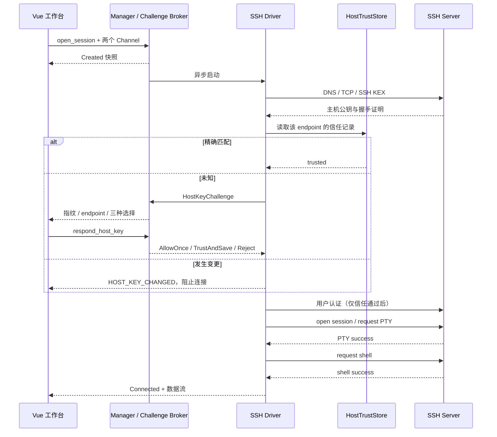

# SSH 连接、安全信任与认证

日期：2026-10-16。首期直连 SSH2 已按 russh 0.64.1 源码实现；本轮仅静态检查，用户反馈的密码/公钥 + OTP 互通修复仍待复验。依赖公告与待验收项见 [需求与实现状态](01-product-requirements.md#8-当前实现与限制)。

## 1. 连接配置

`SshProfile`：address、port（默认 22）、username、authPlan、terminalType（默认 xterm-256color）、初始 rows/cols、timeoutPolicy、keepAlivePolicy、algorithmPolicyRef。保存记录只包含公共或主机专属 credentialRef；私钥从凭据库读取，不在连接时引用原文件，不包含密码、私钥内容或 OTP。

address 输入不支持夹带端口或 shell 片段；UI 分别处理端口，允许域名/IPv4/IPv6，后端拒绝控制字符与嵌入 NUL。IPv6 展示时加括号，但 canonical key 不依赖字符串拼接猜测。DNS 用于定位网络目标，不能代替 SSH 主机身份校验。

## 2. 正常流程

上图为逻辑流程，不意味着 driver 直接引用 UI；实际通过 core 控制事件和 Tauri 桥接。引用凭据可在配置中存在，但秘密读取/提交应尽量延后至主机身份通过之后。

## 3. 主机密钥策略

### 首次信任

russh Handler 的 server key 检查接入 HostTrustStore。未知 endpoint 暂停握手，由独立控制 Channel 呈现：原输入 host、实际端口、key algorithm、SHA256 指纹、连接来源。提示用户通过可信渠道核验，不能声称首次弹窗本身已证明主机可信。

- Reject：默认选项，结束连接。
- AllowOnce：只限当前连接尝试；不写 SQLite，重连再次询问。
- TrustAndSave：验证 challenge 仍有效，在事务内持久化完整公钥及元数据，成功后继续。写失败不得静默变成永久信任；用户可以重新选择 AllowOnce。

Challenge 绑定 session、owner、key digest 和 endpoint；超时、取消、窗口关闭、阶段改变立即作废；只能成功消费一次。两个并发连接对同一 endpoint 的确认需事务内重查，出现冲突时按变更阻断处理。

### 身份与匹配

信任范围为应用内显式规范化后的 host + port，不自动按解析后的 IP 合并别名。规范化域名大小写、IPv6 表示，明确存储输入名与规范名；不自动推导通配符信任。

每个 endpoint 可保存多把经用户显式核验的完整公钥。匹配必须比较完整公钥类型和内容，不只比较 UI 指纹字符串；“发现一个新 algorithm 所以查不到同算法记录”不能当成新主机绕过现有 pin。endpoint 已存在信任但服务端本次 key 不属于集合，一律 HOST_KEY_CHANGED。

首期不实现主机证书 CA、`@cert-authority`、hashed known_hosts、自动轮换证明，也不自动读取/覆盖 `~/.ssh/known_hosts`。后续通过专用导入设计扩展，遇不支持项明确提示。

### 密钥变更

连接阶段直接阻断，展示历史与当前指纹。普通弹窗无“自动接受变更”快捷路径；用户须先通过带影响说明的信任管理界面撤销/替换，重新连接并核验。所有重连都重新检查，不能复用上次 AllowOnce。

## 4. 认证策略

`authPlan` 只保存一个主要认证方式及凭据引用，不保留旧版有序步骤兼容；不是无限尝试所有本地密钥。用户无需配置“密码 / 私钥之后继续交互认证（OTP）”。主机身份通过后，后端先发送不携带秘密的 `none` 请求查询可用认证方法，再按服务端 `remaining_methods` 与 `partial_success` 协商。服务器若允许 `none`，直接完成认证。

| 方式                 | 首期行为                                                                   | 数据边界                                |
| -------------------- | -------------------------------------------------------------------------- | --------------------------------------- |
| 密码                 | 读取公共/主机专属 OS 密码，未设置则 challenge 询问                         | 不写入主机配置/SQLite/Pinia 持久化      |
| 私钥                 | OpenSSH Ed25519 与 RSA-SHA2 优先；从 privateKey 凭据读取正文及可选解密密码 | 前端仅见文件名/公钥指纹，完整私钥不回传 |
| 私钥解密密码         | 可随私钥凭据保存；缺失/错误时通过 masked challenge 本次补充                | 不再独立建凭据；本次补充不自动保存      |
| Keyboard-interactive | 显示 banner/name/instructions 与每轮 prompts，按 echo 标记输入             | echo=false 必须掩码；OTP 永不持久化     |
| partial success      | 保留已完成因素，继续服务器要求的下一步                                     | 不把多因素要求误报成错误密码            |

认证由服务器与配置共同决定；密码 auth 和 Keyboard-interactive 是不同协议步骤。密码 / 私钥部分成功且服务器要求 Keyboard-interactive 时立即进入服务端挑战；仅支持 Keyboard-interactive 的主机不会先索要无效的密码或私钥口令。主认证失败后如服务器仍提供交互认证，也允许自动进入 PAM 表单。配置不含 Keyboard-interactive 步骤，后端不会重复启动已处理的挑战组。保存密码仅自动用于单个非回显、去除两端空白和末尾冒号后精确为 Password（不区分英文大小写）或“密码”的提示，每次连接最多一次，且只使用当前密码认证配置的凭据；已提交过密码协议时不再自动填入。重复提示、失败重试、OTP、复合提示、回显或未知字段由用户输入，OTP 不持久化。服务端零输入且名称/说明均为空白的轮次自动发送零个响应，不产生 AuthChallenge；含非空通知的零输入轮仍显示。所有轮次先校验相同提示限额，并计入八轮预算；此行为由 Rust 统一处理，覆盖终端和双栏 SFTP。常见 password+OTP 需要真实服务器验证；文档有方法并不表示应用已兼容任意 PAM/MFA。

首期密码提交共享最多 3 次预算，私钥口令最多 3 次重新输入；交互认证最多启动 3 次，所有交互尝试共享最多 8 轮 challenge（均为初始上限），每轮设置期限；服务端提示数量、单条长度和总字节数均需限额。拒绝复用旧 challenge。不要将完整 server banner 当作可信富文本，所有提示按普通文本显示。

Agent、Pageant、证书、FIDO、安全密钥、PPK/PEM 全格式与 GSSAPI 不纳入 M2 承诺；不支持时明确说明，不默认调用系统 ssh 回退。

## 5. PTY、Shell 与数据

认证成功后开 session channel，依次请求 `TERM=xterm-256color` PTY 与交互 Shell，并等待相应协议成功响应。有些方法返回值只说明请求发送成功，具体接受状态应以选定 release 的回复机制处理。

初始尺寸来自已挂载且有效的 xterm；可暂用 80×24 兜底，随后以可见实测尺寸更新。resize 校验 rows/cols 为 1–1000 的整数，去重并合并，只发 window-change，不重建会话。不要默认在远端执行 locale 设置命令；UTF-8 显示与远端 locale 不一致时提示用户调整。

输入作为 bytes 保序写入。TTY 模式的 Ctrl+C 发送终端控制字节，由远端 PTY 行规处理；不得把用户键盘行为翻译成本地进程终止。处理 Data/ExtendedData、EOF、ExitStatus、ExitSignal、Close；PTY 输出中 stderr 合并展示，底层仍保留扩展类型供诊断，不尝试从字节流还原标准输出边界。

普通终端复制选区不应向远端写数据；中文输入法组合阶段不提前发送不完整字符；粘贴使用终端支持的 bracketed paste 与输入队列。

## 6. 超时与保活初始策略

| 阶段           | 初始值（待测）                     | 处理                                  |
| -------------- | ---------------------------------- | ------------------------------------- |
| DNS            | 10 秒                              | 独立取消/错误阶段                     |
| TCP            | 总预算 15 秒                       | 多地址尝试共享预算，含 IPv6/IPv4 回退 |
| SSH 握手       | 20 秒                              | 与等待用户确认分开计时                |
| 主机信任       | 120 秒                             | 超时拒绝，提示重新连接                |
| 认证交互       | 每轮 120 秒，总交互预算 10 分钟    | 防无限 challenge；用户可随时取消      |
| 非交互认证请求 | 30 秒                              | 明确失败，避免重复提交秘密            |
| PTY / Shell    | 每步 10 秒                         | 请求拒绝与超时分开                    |
| KeepAlive      | 30 秒空闲探测，连续 3 次无回复判定 | 实际语义按选定 russh release 验证     |
| 关闭           | 3 秒资源回收预算                   | 到期释放 transport 并报告清理结果     |

握手等待信任时不继续消耗 20 秒网络超时；要么拆分阶段定时器，要么显式暂停并保留 120 秒挑战期限。KeepAlive 不等于“用户 N 秒没按键就退出”；默认不设用户活动空闲断线。系统睡眠唤醒后若存活性不明，呈现检测状态，失败后终止旧 session，等待用户重连。

## 7. 算法与兼容性

默认使用锁定 release 的安全算法列表，在设计审核时记录实际协商策略，优先现代 KEX/AEAD、Ed25519/RSA-SHA2；禁用 DSA、ssh-rsa/SHA-1 签名及弱 KEX 的自动回退。RSA 密钥格式不等于使用 ssh-rsa SHA-1 签名。

库“支持算法”与项目“启用算法”分别记录。老旧交换机若需要弱算法，后续通过单主机显式策略开启，并显示影响；不得全局放宽。首期不自行设计密码算法，不承诺因使用 Rust 就没有安全漏洞。

## 8. 重连与未来专业功能

重连建立新的后端连接：新 requestId/sessionId、重新握手、检查主机密钥、重新认证；不重放输入、不重新执行 snippet。**同一 Tab、terminalId、xterm 实例和滚屏缓冲必须保留**，新输出在原终端末尾继续追加，不创建替代视图或清空缓冲。断线、首次连接失败、重连失败均保留 Tab 和历史滚动/复制/搜索能力；没有历史的首次失败也保留空终端与可查看的错误信息。

新旧连接之间通过可信本地状态消息标识时间与重连结果，不把错误当作新远端输出；旧流排空、代次隔离及终端模式边界见 IPC/交互文档。保留显示历史不代表恢复原远端 Shell；远端任务恢复仍需 tmux/screen 等远端能力。

ProxyJump 后续通过明确 hop 列表，为每一跳独立校验密钥与认证；不接受任意 ProxyCommand 自动执行。单终端 SFTP 经独立子系统复用已认证连接，生命周期仍绑定终端；独立双栏使用文件专用 SessionManager 与 files-only 工厂，只认证并开放 SFTP channel，不请求 PTY/Shell，复用密码/私钥/keyboard-interactive 与主机信任端口；通用共享连接租约仍为后续设计，见架构文档，不向通用终端加入 listFiles/startTunnel 等方法。

## 9. 源码与验证边界

实现位于 terminal-ssh 的 connection/host_key/auth/driver。固定配置为 256 KiB SSH window、32 KiB maximum packet、16 条 channel 消息、30 秒 KeepAlive 与 max=3；russh 收到包会重置保活计数，且超出 max 才断开，不能解释为精确 90 秒。库内部 channel 满时的协议公平性仍须 SP-05 验证，socket shutdown 取消不依赖输出 ACK。

已静态核对 russh 0.64.1 的认证、交互及 PTY/Shell API。当前源码不等于认证互通验收：公共/专属密码、加密/无密码私钥、密码或私钥加 OTP、仅 PAM、错误重试、取消与超时仍须真实服务器验证。RSA 算法选择不消除实现侧信道风险，依赖公告见 [需求与实现状态](01-product-requirements.md#8-当前实现与限制)。

## 10. 一次性主机系统识别

仅保存SSH终端生效，开关detectSshSystem缺失时默认true；Local、临时SSH、files-only及未来Telnet不启动检测。PTY/Shell建立后与driver并发运行，RemoteSystemStore先按主机ID、目标快照和默认图标事务claim，持久化systemDetectionAttempted与session令牌。无标记且图标为ssh才允许claim；失败、超时、断开或进程中断均不撤销标记，后续连接永不自动重试。修改连接目标不重置标记；复制新主机保留icon但独立计算新主机的尝试状态。

kex_done采集受界SSH服务端标识，仅作展示线索。完整平台词或明确软件标识可直接归类；其余通过同一transport的独立exec channel执行echo $SHELL，再选择POSIX/Fish/RouterOS脚本，必要时尝试固定Windows版本查询。没有Termius版本对OpenSSH版本的执行限制，不承诺设备都支持exec。普通脚本优先/etc/os-release、/usr/lib/os-release，再回退release文件；仅Rust按文本解析ID、NAME、DISTRIB_ID、ID_LIKE等，不source，不拼接远端返回值为命令。

全部exec共用5秒截止时间与32KiB stdout/stderr预算，每次最多一个探测channel，必须等待exec协议Success和退出码；仅stdout用于解析。超时/取消/超限关闭探测channel，不向PTY注入命令、不显示探测正文、不进入输入广播或修改交互Shell。检测结果只有白名单图标类别；失败不改变会话状态。complete校验令牌、目标及仍为默认图标，防止删除/目标变化/手动选择被迟到结果覆盖；提交后发hostSystemChanged控制通知重读主机。改变icon或目标会作废旧令牌，但不清除一次性标记。

内置命令与设置页共用resources/ssh-os-detection.json；设置仅提供开关和只读文本，不提供脚本编辑或任意exec IPC。检测会在远端执行内置只读命令，可能被服务器审计。当前仅静态验证，运行兼容性和故障矩阵待验收。
