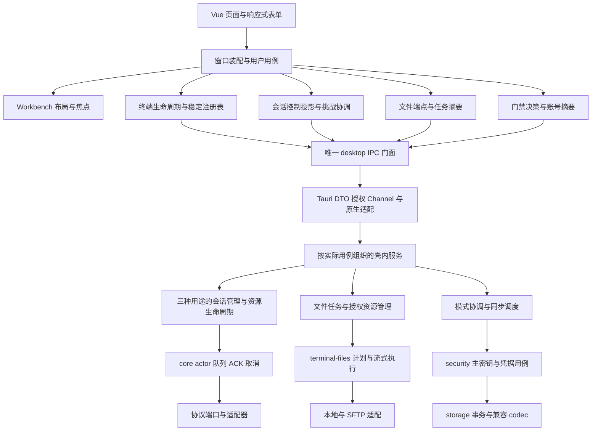

# 代码结构评估与渐进重构方案

日期：2026-10-20。状态：**分析与实施建议，尚未实施**。本次以当前工作区源码（包括未提交修改）为依据，结合需求和近期路线，由前端、Rust 会话/文件、数据/同步三个分析方向交叉审阅。源码行号用于定位本次证据，后续修改可能使行号移动。

## 1. 结论与适用范围

当前架构的主方向适合 Termeta：Vue 管理交互和轻量投影，Rust 管理连接、秘密、文件与持久化，协议核心独立于 Tauri。无需重写前后端，也无需先建立更大的框架。主要不适配发生在**业务演进后状态仍归旧模块所有、异步操作缺少完整生命周期、同库操作仍沿用两阶段写入，以及展示/传输模型直接参与领域判断**。

建议先修正有明确时序或控制流证据的问题，再收敛生命周期与事务职责，最后随本地文件端点等近期能力引入必要抽象。机械拆长文件、全面改依赖注入或先建设通用连接池，都不能解决已经发现的问题。

本报告审阅的是本仓库的 Vue/TS 前端、Tauri 壳和九个 Rust crate；独立 Python 官方服务端、用户端与管理端仅作为客户端契约背景，未进行其源码实现审计。没有构建、启动、执行项目测试、连接主机/串口/真实云服务。下文“逻辑缺陷”表示可由源码推导的错误路径，**不表示已经运行复现**；性能结论仅为风险，未测量。

### 1.1 与当前产品和近期路线的对应

依据：[产品需求](01-product-requirements.md)、[路线](10-roadmap.md)、[架构](03-architecture.md)、[会话](04-session-model.md)、[IPC](06-ipc-and-streaming.md)、[SFTP](16-sftp-workspace.md)、[工作区](18-terminal-workspaces.md)、[存储](07-storage.md)、[备份](22-data-backup.md)、[官方同步](26-official-vault-sync.md)。功能状态仍只以产品需求为准。

| 产品事实或近期门槛 | 结构上必须支持的行为 | 本报告对应方向 |
| --- | --- | --- |
| 四协议终端、多标签、分屏、广播已有源码；首先验收连接/关闭/重连 | 稳定 terminalId；旧流隔离；输入不重放；输出排空与取消独立 | R03、R08、R09 |
| 关闭视图才归档日志，失败保留视图；退出需等待提交 | 单一、幂等、可失败重试的关闭用例 | R08 |
| 主机、分组、系统识别、官方合并同时更新列表 | 读写竞争隔离；关联数据的一致读取 | R01、R11 |
| 官方模式密码门禁与自动全量同步已有源码，故障恢复待验收 | 访问资格与同步健康分开；账号/来源/代次一致 | R05、R06、R12 |
| 本地离线模式手动第三方备份已有源码 | 模式限制覆盖整个操作；预览与提交不能越过模式切换 | R06 |
| 双远端、侧栏、对拷和轻量传输已有源码；本地端点/完整管理仍未完成 | 端点身份、授权、任务所有者、传输执行分开 | R04、R10 |
| Local 自定义启动、进程树清理、Serial 扩展等仍有余项 | 协议配置按类型表达；设备与平台能力独立演进 | R03、R11 |
| 当前不是三平台或发布验收完成版本 | 重构以行为不变量和故障场景验收，不能用格式/类型检查替代 | 第 6、7 节 |

睡眠恢复、整库配对备份、updater 等仍按路线推进。本报告不把团队、远程协助、第三方自动双向同步、自动恢复标签等后续能力提前纳入本轮重构。

### 1.2 必须保留的已有设计

- `TerminalStage` 的稳定宿主、布局树与终端实例分离；切页、分屏、迁移和配色不销毁 xterm。注册表与 `runtime/{view,stream,events,session}` 已经分责，不应重新合成一个大组件。
- 会话 actor、有界字节队列、二进制 Channel、消费后 ACK、输入序号与连接代次隔离。文件和转发不申请 PTY/Shell，不共用终端输入流。
- 唯一 desktop IPC 门面、CommandRegistry、窗口与资源 owner 校验。权限重构不能只剩 capability 声明。
- SQLCipher、应用迁移校验、Rust 持有主密钥/凭据、云包白名单。已应用迁移保持原始字节，特别是迁移 4；任何 schema 变更新增迁移。
- 官方同步的稳定 ID、账号/来源隔离基线、三方合并、CAS、认证 bundle 一致选择和信任冲突拒绝。观察到的远端基线与本地合并结果的事务关系必须保留。
- Naive UI 薄适配、共享响应式表单、五语言语义 key；不以架构调整为由复制控件皮肤或重做现有技术栈。

## 2. 问题总览与优先级

P1 表示建议在对应功能完整验收前处理；P2 表示按功能触发或证据逐步实施。没有仅凭文件长度认定缺陷，也没有把未实现功能本身作为结构错误。

| 编号 | 分类 | 优先级 | 核心问题 | 建议落点 |
| --- | --- | --- | --- | --- |
| R01 | 逻辑缺陷 | P1 | 主机旧读取可覆盖已提交的写结果 | Store 读写代次、一致快照 |
| R02 | 逻辑缺陷 | P1 | 解锁初始化重试可叠加设置订阅 | 幂等订阅与可重试加载分开 |
| R03 | 控制流缺陷 | P1 | Local 等待输入转交时不再驱动输出泵 | 独立输入泵、并发驱动 |
| R04 | 身份建模缺陷 | P1 | SFTP 用显示标题判断同一端点 | 内部 EndpointIdentity |
| R05 | 逻辑缺陷 | P1 | 启动同步网络/CAS 错误被归为需密码 | 错误分类、门禁转换 |
| R06 | 并发边界缺口 | P1 | 第三方备份模式准入与账号切换不协调 | 模式操作租约 |
| R07 | 失败恢复缺口 | P1 | 公共凭据两步写入残留不可用 pending | 同库单事务、历史状态恢复 |
| R08 | 结构债/资源风险 | P1 | 关闭/归档事实由多处状态组合表达 | 终端生命周期控制器 |
| R09 | 结构债/异常时延风险 | P2 | 会话摘要、挑战与附属资源终止分散 | 控制投影、资源生命周期联动 |
| R10 | 近期扩展阻力 | P2；本地端点开发前 | 文件队列依赖终端，provider 不足以共享执行 | 端点/任务/执行三层 |
| R11 | 结构债 | P2 | 多协议与工作区被塞入 SSH 形状 | 类型化模型、兼容适配 |
| R12 | 结构债/性能风险 | P2 | 查询兼做同步；全量编解码穿透事务 | 状态查询、同步用例、领域快照分开 |
| R13 | 已发生的契约偏差 | P1 小范围修正，P2 治理 | TS 未完整描述 Rust 事件与错误语义 | 完整契约、领域错误映射、静态守卫 |

## 3. 先处理的逻辑与可靠性问题

### R01：主机 Store 的“最新读取”不等于“最新状态”

证据：[hosts/store.ts:15](../src/modules/hosts/store.ts#L15) 在 `load()` 中递增代次，随后整体替换 hosts/groups；[写入路径:31](../src/modules/hosts/store.ts#L31)、[工作区保存:43](../src/modules/hosts/store.ts#L43)、[删除:54](../src/modules/hosts/store.ts#L54)、[分组保存:72](../src/modules/hosts/store.ts#L72) 成功后均未使在途旧读失效。系统识别 [events.ts:46](../src/modules/terminal/runtime/events.ts#L46) 和备份/同步通知 [App.vue:104](../src/App.vue#L104) 都能触发读取。

可发生的时序：读取取得旧快照 → 保存或删除提交成功并更新 UI → 原读取返回并整体覆盖。结果是界面中的编辑回退、删除项重新出现或 revision 变旧；这不是已经证明数据库丢失，但会误导下一次操作。[forwarding/store.ts:147](../src/modules/forwarding/store.ts#L147) 已有写后增加读取代次的处理，可以复用这一原则。

**方案：**先在每次成功写入后失效更早的读取，保留“提交成功直接更新摘要”的行为，不把后续刷新失败误报为写失败。再把 hosts/groups 变成一次事务快照读取，避免两次并行 IPC 在分组删除或官方合并前后取得不一致关联；仅此新增聚合接口时才补齐 Rust/TS/handler/ACL。UI 请求代次只用于防迟到，不能替代 Rust revision 或数据库事务。

回归：控制读取返回顺序，分别与保存、删除、收藏/迁移、工作区保存、系统识别和官方合并交错；最终 UI 与已提交状态一致。

### R02：设置订阅与解锁初始化具有不同生命周期

证据：[useSettingsSync.ts:26](../src/modules/settings/useSettingsSync.ts#L26) 每次 `start()` 都建立监听并覆盖 `stop`；卸载只释放最后一个。[App.vue:113](../src/App.vue#L113) 将订阅、主机读取、转发读取放入同一个 `Promise.all`；[VaultGate.vue:162](../src/components/VaultGate.vue#L162) 在任一分支失败后保留未初始化状态，重试会再次调用 `start()`。

因此，订阅成功而主机加载失败即可积累监听与重复重读。现有“先订阅再读取”和串行读写原则是正确的，缺的是幂等性。

**方案：**`start()` 使用单飞 Promise，并区分“监听已建立”和“初次读取成功”；重复进入只重试读取。窗口级订阅只建立/释放一次，保险库可用后的业务数据初始化单独重试。保留异步订阅在卸载后立即释放的保护。

回归：首次加载某一分支失败、多次重试、订阅建立过程中卸载；一次通知只触发一次有效重读，卸载后无残留回调。

### R03：Local 输入背压可能阻断输出推进

证据：[terminal-local/lib.rs:141](../crates/terminal-local/src/lib.rs#L141) 创建容量为 1 的输入转交队列；[164 行](../crates/terminal-local/src/lib.rs#L164) 的输出泵依赖外层 `select!` 驱动；[182 行](../crates/terminal-local/src/lib.rs#L182) 收到输入后，嵌套等待 `input_send.send()`，仅继续观察取消，不再轮询输出、进程退出和 resize。

可构造条件为：子进程持续输出但暂不读取 stdin；PTY 写线程阻塞，输入转交队列满；actor 等待转交时停止消费输出，子进程又可能因输出阻塞而无法进入读输入阶段。取消仍能打断这一等待，不能把该问题表述为“取消完全失效”。

**方案：**将输入转交建为独立控制泵，与输出、进程状态、resize、写入失败一起在外层驱动，或把发送许可等待显式纳入外层事件选择。保持有界预算，不以扩大缓冲规避双向等待。[SSH driver:45](../crates/terminal-ssh/src/driver.rs#L45) 的独立泵可供参考，但不要求不同协议共享同一个驱动实现。Serial 类似等待有写截止时间，需在后续设备验收中检查公平性，不能直接认定同等死锁。

回归：受控进程同时大量写 stdout/接收 stdin；输入端暂停消费时输出与退出检测仍推进，关闭可及时生效。真实 PTY/三平台验证另行授权。

### R04：SFTP 的显示标题不能承担文件端点身份

证据：[file_workspace.rs:141](../src-tauri/src/commands/file_workspace.rs#L141) 仅当两个 `SessionSnapshot.title` 相等才执行真实路径自复制检查；[SessionConfig::title:335](../crates/terminal-core/src/types.rs#L335) 的 SSH 标题仅为 `username@address`，没有端口，也未规范化域名。

同用户名、地址但不同 SSH 端口的两个服务会被误认为同端点，相同路径可能错误拒绝合法对拷；同一域名的大小写或末尾点不同又可能漏过已有自复制检查。这里是身份语义错误，不能靠修改展示字符串修复。

**方案：**在 Rust 内为已认证端点保留独立身份，至少包含规范化主机、端口、用户名；复用现有 [Endpoint 规范化:211](../crates/terminal-core/src/types.rs#L211)。主机密钥身份可以补充证据，但不能单凭同一密钥断言同一文件命名空间。保留 REALPATH 和父子目录检查；未知别名、硬链接、服务器命名空间与并发替换仍有产品已说明的边界。

回归：同地址不同端口、域名大小写/末尾点、不同用户、同路径和子路径；显示标题变化不影响复制判断。

### R05：访问门禁和同步错误需要分别决策

证据：[official_sync/service.rs:42](../src-tauri/src/official_sync/service.rs#L42) 对已确认账号、本机已解锁且无需重新认证的启动恢复调用同步，后续错误在 [45 行](../src-tauri/src/official_sync/service.rs#L45) 一律转成 `needsPassword`。[sync.rs:108](../src-tauri/src/official_sync/sync.rs#L108) 的 PUT 网络错误和 [133 行](../src-tauri/src/official_sync/sync.rs#L133) 的三次 CAS 冲突耗尽都可到达此分支。

同一条件下，第一步 GET 失败且存在基线时，[service.rs:56](../src-tauri/src/official_sync/service.rs#L56) 却保留离线 ready；密码确认后的同步和后台同步遇到同类网络/CAS 错误也保留使用资格。真正的云密码变化已有 [sync.rs:38](../src-tauri/src/official_sync/sync.rs#L38) 专门判断，因此当前故障结果依赖失败发生在哪一步。

**方案：**先修复错误分类：新登录/未确认账号、本地锁定、明确密钥变化继续保持严格门禁；已确认且具备恢复条件的网络失败、有限 CAS 冲突保留本机访问资格并显示同步故障。损坏包、认证撤销和存储故障分别定义处理，不能全部按可重试网络错误放行。随后用封闭枚举分别表达 `AccessState` 与 `SyncState`，统一转换入口；先适配现有 IPC 摘要，避免一次修改全部界面。

前端 [VaultGate.vue:162](../src/components/VaultGate.vue#L162) 的初始化、[181 行](../src/components/VaultGate.vue#L181) 的检查以及账号/同步 watcher，可进一步拆成纯门禁决策函数和负责代次的异步控制器。Vue 留下响应式表单及展示，保留 `inspectGeneration` 和账号隔离保护，不引入通用状态机依赖。

回归：GET 失败、GET 成功后 PUT 超时、连续 409、云盐变化、撤销账号、无基线新设备、锁定已有本地库、账号切换中的迟到结果。不能用云密码绕过本地解锁。

### R06：模式约束不能只检查调用开始时的账号状态

证据：[backup.rs:14](../src-tauri/src/commands/backup.rs#L14) 读取账号确认离线；[account/service.rs:67](../src-tauri/src/account/service.rs#L67) 的状态锁在返回时释放。后续第三方操作使用 backup 自己的操作占用，而 [OAuth install:42](../src-tauri/src/account/service.rs#L42) 持另一把账号提交锁。[恢复提交:211](../src-tauri/src/commands/backup.rs#L211) 虽再次检查模式，检查到等待 vault 操作锁/数据库提交之间仍可交错。

存在源码可见的准入窗口：第三方操作通过离线检查 → 官方账号安装完成 → 原第三方上传或恢复继续执行。这是操作期协调缺口；本次没有证明真实云数据已经发生混用。

**方案：**建议明确采用“已接受的第三方操作完成或取消后，再提交模式切换”的策略。模式协调器在短临界区登记操作租约；切换进入过渡态后拒绝新第三方任务，等待已有任务结束，等待发生在锁外。不要把网络等待放入全局锁，也不要误以为事后检查代次可以撤回已上传的内容。预览令牌绑定模式代次，模式切换后失效。账号、同步、改密的锁序及不可中断提交边界需一起记录。

回归：用屏障控制登录完成与上传、下载、预览、恢复提交交错；切换不会静默越过离线限制，等待/取消有明确 UI 结果，原子恢复提交不被窗口销毁截断。

### R07：公共凭据应使用同库原子写入

证据：[vault.rs:57](../crates/terminal-security/src/vault.rs#L57) 先插入 pending，再通过 [persist:96](../crates/terminal-security/src/vault.rs#L96) 写秘密并置 ready；私钥同样在 [92 行](../crates/terminal-security/src/vault.rs#L92) 分两步。底层 [credentials.rs:62](../crates/terminal-storage/src/credentials.rs#L62) 与 [105 行](../crates/terminal-storage/src/credentials.rs#L105) 各自提交 SQL。

第二步失败或两步之间退出会留下公共 pending。启动协调会清理主机专属孤立凭据及 deleting，但 [credentials.rs:89](../crates/terminal-storage/src/credentials.rs#L89) 限定了主机 owner，[vault.rs:200](../crates/terminal-security/src/vault.rs#L200) 又跳过非 deleting；公共 pending 留在列表，却不能作为 ready 凭据使用。影响是失败残留不可用条目，不是凭据泄露或整库故障。

**方案：**私钥文件读取/校验在事务外完成；公共凭据元数据、secret 与 ready 在一个 SQLCipher 事务内提交。对主机专属密码继续分析替换引用与旧秘密回收边界，再逐步收敛同库原子操作，不能直接删除全部恢复状态。历史公共 pending 制定可解释的清理策略，先确认无引用，不伪造 secret 或无条件变 ready。无需更换加密格式或改写已有迁移。

回归：插入后失败、secret 写失败、进程中断、事务回滚、旧凭据仍可用、历史 pending 清理及 referenced/deleting 的兼容处理。

## 4. 结构调整与近期功能承接

### R08：终端关闭/归档应由一个用例拥有

证据：[runtime/entry.ts](../src/modules/terminal/runtime/entry.ts) 保存 connecting/closing/disposed 与流结束状态；[workbench/store.ts:68](../src/modules/workbench/store.ts#L68) 另存 closingTerminalIds；[useTerminalClose.ts:15](../src/modules/workbench/useTerminalClose.ts#L15) 管理标签/窗格关闭；[useMainWindowLifecycle.ts:29](../src/layout/useMainWindowLifecycle.ts#L29) 又编排窗口退出；[runtime/session.ts:97](../src/modules/terminal/runtime/session.ts#L97) 实际负责等待连接、结束、排空、ACK、日志提交与销毁。

拆分本身合理，问题在于“关闭已开始、可重试、提交成功”这一业务事实没有单一所有者。例如终态错误展示依赖 [events.ts:79](../src/modules/terminal/runtime/events.ts#L79) 的 closingTerminalIds，而窗口退出与普通关闭设置该标记的方式不同。窗口退出还对全部终端并行归档，多个大滚屏快照可能形成瞬时内存峰值；本次未测量。

**方案：**在现有 terminal 模块内引入每视图生命周期控制器，统一拥有连接代次、在途连接 Promise、幂等关闭 Promise、尾输出栅栏与归档提交结果。暴露一个关闭并归档用例供标签、窗格与窗口退出调用；确认文案/策略留在 UI 编排层，Workbench 在成功后移除布局引用。当前布尔状态可先成为控制器的只读投影，逐步减少多处写入；轮询等待逐步替换为明确完成信号。

保留失败时的 xterm、历史和可重试视图，保留同 terminalId 的日志幂等。退出归档可先采用小并发上限，具体值依据测量确定；不把所有 xterm/输出放进 Pinia，也不因控制器重建宿主。

回归：重复关闭、连接中关闭、重连与关闭竞争、单个日志写失败、四协议尾输出、20 终端退出时一个失败后重试、布局移动期间关闭。

### R09：会话控制投影与附属资源终止需要独立归属

**前端证据：**[Workbench:66](../src/modules/workbench/store.ts#L66) 保存三类连接的标题/挑战；终端 [events.ts:19](../src/modules/terminal/runtime/events.ts#L19)、文件 [SftpBrowser.vue:53](../src/modules/files/SftpBrowser.vue#L53)、转发 [forwarding/store.ts:63](../src/modules/forwarding/store.ts#L63) 分别处理 revision、presence、挑战和终态。文件/转发认证需要共享弹窗，但不属于终端布局。

建议提取轻量会话控制投影及挑战协调器，统一 sessionId、用途、请求代次、revision、presence、挑战失效；终端 runtime、文件端点和转发 runtime 仍各自拥有业务生命周期。Workbench 保留标签、布局、焦点及广播成员，不再成为所有连接控制信息的归属地。统一投影不拥有终端字节，也不抹平各类会话的不同能力。

**Rust 证据：**显式 [close_session:297](../src-tauri/src/commands/sessions.rs#L297) 立即取消 SFTP 浏览器；[心跳:371](../src-tauri/src/commands/sessions.rs#L371) 直接调用 manager close；远端终态对浏览器的后端清理主要依赖 [lib.rs:127](../src-tauri/src/lib.rs#L127) 的 30 秒维护循环。常规侧栏有 [SftpPanel.vue:412](../src/modules/files/SftpPanel.vue#L412) 的前端取消补偿，因此不能称所有正常断线必然等待 30 秒；问题在于后端异常路径保证依赖不同入口。

建议 core 发布不含 Tauri/SFTP 依赖的生命周期信号，壳内统一撤销该 session 的浏览器、任务取消令牌、原生承诺及等待确认。显式关闭、心跳回收、远端结束、owner 销毁共享清理入口，维护循环保留为兜底。事件回调不得持 manager 表锁等待，也不得阻塞 ACK/KeepAlive/挑战响应。

保留三个 SessionManager 的独立资源与用途边界。后续先用类型化资源引用和用途枚举减少三表探测/布尔用途组合；不要为统一而把文件/转发变成终端，或把三类配额合成一个不区分用途的池。

回归：三类会话并发认证、旧挑战失效、迟到终态、无前端补偿的断线、选择器/覆盖确认/扫描/传输中的关闭和 owner 销毁。

### R10：文件工作区按“端点、任务、执行”演进

证据：[useSftpTransferQueue.ts:7](../src/modules/files/useSftpTransferQueue.ts#L7) 必须接收 TerminalItem，并在 [76 行](../src/modules/files/useSftpTransferQueue.ts#L76) 直接写 sftpTransferring；任务用 upload/dropId/dragNames 等可选字段推断种类。双远端 [SftpBrowser.vue:138](../src/modules/files/SftpBrowser.vue#L138) 另持对拷取消/进度。侧栏和独立端点也各自维护分页/导航/选择代次。

Rust [FileProvider:66](../crates/terminal-files/src/lib.rs#L66) 当前只提供 list；[SFTP copy:13](../crates/terminal-sftp/src/copy.rs#L13) 的两端固定为 SftpBrowser。本地上传扫描、下载扫描、远端对拷分布在壳和 SFTP crate。直接增加本地栏，容易继续形成四方向复制编排，并重复冲突、扫描上限和取消规则。

**建议边界：**

| 层 | 拥有的责任 | 明确保留的边界 |
| --- | --- | --- |
| Vue 文件界面 | 导航/选择/分页投影、轻量任务摘要、用户操作 | 侧栏和双栏保留各自布局；共享目录控制逻辑即可 |
| 壳内文件应用服务 | owner-bound 端点/本地授权、任务登记、操作占用、许可、取消、原生选择器/确认适配 | commands 保留 DTO/owner/Channel，不向前端开放任意路径 |
| terminal-files | 真实需要的 metadata、目录、reader/writer 端口；共享扫描计划、限额与执行 | 复用现有 64 KiB 流式复制；不依赖 Tauri |
| local/SFTP 适配 | 平台文件访问或 SFTP 请求、句柄关闭与路径语义 | 本地和远端路径规则分别实现，不共用远端字符串拼接处理本地路径 |

前端任务改为 upload/download/copy/nativePromise 等判别联合，引用 EndpointRef，owner 表示终端侧栏或固定文件工作区。关闭确认从统一任务摘要查询，不再要求工作台同时检查全局布尔值和每终端布尔值。原生拖出“兑现请求前不显示任务”、一次性 dropId、隐藏保活、终端断开取消和重连不重放全部保留。

壳内先抽取真实重复的任务登记/取消/RAII 清理，避免 commands 继续直接管理 SftpBrowser 的公开 operation/transfer 锁。原生覆盖确认通过窄回调注入执行流程。等实现本地端点时再补必要 provider 能力，避免先造一个覆盖所有未来功能的大接口。

连接租约先解决现有独立连接“谁持有、何时释放”，不立即做 SSH 池化。只有明确 owner、用途、配置快照、身份、最后持有者和断线传播后才考虑共享传输；侧栏仍随终端关闭，固定双栏仍为独立连接。持久化队列、断点续传、跨重启恢复继续不在本轮范围。

回归：现有三方向行为不变；新增本地端点时覆盖四方向、目录/链接/限额、反向对拷不死锁、许可释放、进度通道失效、取消早于登记、部分完成结果。上传覆盖/目录合并仍不承诺回滚，下载仍拒绝覆盖。

### R11：区分 wire DTO、领域配置与展示摘要

证据：[TS HostProfile:35](../src/services/desktop/types.ts#L35) 继承 SSH 配置，serial/telnet/workspace 都被迫携带 address/port/username/authPlan；serialConfig/workspace 为可选字段，kind 不能保证对应数据存在。Rust [model.rs:32](../crates/terminal-storage/src/model.rs#L32) 同样为扁平结构及自由字符串 kind；[workspaces.rs:67](../crates/terminal-storage/src/workspaces.rs#L67) 必须构造空 SSH 字段，[90 行](../crates/terminal-storage/src/workspaces.rs#L90) 的工作区元数据更新又校验这些无关字段为空。

这不是现有统一列表有错。主机页确实需要混合展示连接和工作区，但统一展示基础信息，不意味着所有实体应共用 SSH 领域形状。已有 OpenTarget 判别联合是更适合协议配置的方向。

**方案：**保留现有数据库和 IPC 兼容表示，先在受控适配层转成“共享保存项元数据 + SSH/Telnet/Serial/Workspace 判别联合”。各编辑器用对应草稿，连接展开仅接受真实连接，工作区布局在类型上必须存在。收藏/分组等公共操作逐步使用窄命令或明确映射，不再把完整旧配置反复提交。

TS 的业务模型放在对应领域，wire 契约放 desktop 契约层；Rust 的序列化/存储读取处负责显式映射。不要维护两套互相猜测的字段：适配函数应为唯一转换处，有兼容样例；若修改 wire，必须同轮修订 Rust/TS 和版本处理。将来 Local cwd/env/argv 或 Serial HEX 能力进入自己的配置，不继续加入 SSH 默认字段。

设置同样需要一个明确边界：[Rust settings validate:32](../src-tauri/src/settings.rs#L32)、[save_settings:41](../src-tauri/src/commands/settings.rs#L41)、[TS normalize:52](../src/modules/settings/store.ts#L52) 各承担当下兼容、局部合并和热应用。保留现有串行局部保存；将 normalize/validate/patch 的兼容规则集中为可复用入口，逐步采用类型化 patch 或共享契约样例。不要改回整份草稿覆盖，也不要求把所有前端主题展示数据搬进 Rust。

回归：旧配置、四种保存项编辑/复制/搜索/分组、损坏类型字段、工作区引用、官方/第三方往返、旧设置归一化与多窗口局部更新。

### R12：同步服务分开“查询、调度、计算、提交”

证据：[official status:25](../src-tauri/src/official_sync/service.rs#L25) 获取整个同步操作锁，并可能发 GET、合并、PUT；[logout 命令](../src-tauri/src/commands/account.rs) 同样与同步协调。因此“读取轻量状态”在行为上可能是长网络用例。操作级串行化有必要，但不应让 UI 普通查询隐式触发完整恢复。

建议区分读取已发布状态、单次启动恢复、请求同步三个用例；同一账号的普通同步由单一调度入口合并触发，携带 origin/accountId/operation epoch，防止切换后迟到提交。退出的取消与远端撤销应有明确阶段。改密/数据库文件切换仍作为独立关键流程，不能简单通过去掉锁或取消所有 future 来提速。

**计算与事务证据：**[sync.rs:55](../src-tauri/src/official_sync/sync.rs#L55) 解包后导出 before、合并，再分别比较 before/merged 与 remote/merged；[envelope.rs:19](../src-tauri/src/official_sync/envelope.rs#L19) 封包又读取数据库信息。[storage official_sync.rs:677](../crates/terminal-storage/src/official_sync.rs#L677) 先开启写事务，再在事务内等待合并/编码。移到 blocking 线程避免占用异步执行器，不等于缩短 SQLite 写锁。当前不能断言已达到性能瓶颈。

建议按成本递进：

1. 合并返回具名结果，包含业务是否变化、与远端是否一致、统计与兼容快照，消除 before 全量导出和重复解析；不改云包格式。
2. 建立只针对云白名单业务写入的本地 generation，并记录已验证的远端 revision；两者未变化时跳过重算。必须覆盖主机/认证/分组/信任/片段/工作区及同步应用写入，不能用“数据库任何写入”或“前端修改次数”代替；改密与账号变化另作失效条件。未建立完整覆盖前不启用这一快路径。
3. 测量写锁时间、保存延迟和快照峰值后，再决定是否使用“事务一致快照 → 事务外计算 → 写事务复核 generation → 原子应用差异”。冲突时有界重算，不应用过期计划；本地合并与观察到的远端基线仍同事务提交。

另一个结构问题是 [backup/schema.rs:121](../crates/terminal-storage/src/backup/schema.rs#L121) 的三层 Cell 数组和 [official_sync.rs:11](../crates/terminal-storage/src/official_sync.rs#L11) 的表号/列位置穿透领域合并。建议保持现有 SQL/备份编码，在 codec 边界转成具名 BusinessSnapshot/ProfileBundle/TrustRecord，领域规则只处理具名字段；先迁移同步合并，不重写整套 SQLx Repository，不把敏感全量快照送入前端。

回归：稳定 ID、认证 bundle 原子选取、删除/引用闭包、同名修复、信任冲突拒绝、本地写入与同步交错、409/丢响应、旧包兼容、云先改密及本机切换恢复。第三方新增合并与官方三方同步保留独立策略，不能强行共用一套冲突规则。

### R13：跨语言契约已经有偏差，应先补齐再谈自动生成

| 证据 | 当前偏差及实际影响 | 建议 |
| --- | --- | --- |
| [Rust SessionEvent:250](../crates/terminal-core/src/types.rs#L250)、[TS SessionEvent:165](../src/services/desktop/types.ts#L165)、[events.ts:41](../src/modules/terminal/runtime/events.ts#L41) | Rust 必含版本/request/sequence 信封，TS 未完整声明；消费处强转为可选 eventSeq | 定义完整 envelope 与 payload 联合，入口统一校验版本、请求/会话代次和序号，删除临时断言 |
| [desktop.auth:311](../src/services/desktop/client.ts#L311)、[respond_auth_challenge:243](../src-tauri/src/commands/sessions.rs#L243) | TS 允许 savePolicy=save，Rust 仅接受 never；当前主要调用未因此证明失败，但公开类型承诺不存在的能力 | 收窄现有类型，与后端真实契约一致，不实现 OTP 保存 |
| [errorMessage:327](../src/services/desktop/client.ts#L327)、[Local io_error:12](../crates/terminal-local/src/lib.rs#L12)、[Telnet io_error](../crates/terminal-telnet/src/lib.rs#L106)、[SSH driver:81](../crates/terminal-ssh/src/driver.rs#L81) | 所有 IO_FAILED 都被翻成 TCP 连接失败，覆盖本地 PTY 操作失败、已连接后的 Telnet/SSH 中断 | 保留 code/phase 与协议上下文，按领域映射语义 key；未知错误保留后端诊断，不展示成另一种故障 |
| [desktop.write/resize:298](../src/services/desktop/client.ts#L298)、[Rust write:177](../src-tauri/src/commands/sessions.rs#L177)、[resize:191](../src-tauri/src/commands/sessions.rs#L191) | 后端返回 acceptedSeq/有效尺寸，门面未明确结果类型 | 补全结果 DTO，使用方只依赖真实返回契约 |

入口校验的登记顺序必须保留：当前 requestId 在 desktop.openSession 内部生成，控制事件可能早于命令返回的初始快照。迁移时由生命周期控制器先生成并登记 requestId，再交给门面；首次匹配当前请求代次的事件可以绑定 sessionId，随后核对响应一致性。不能等初始响应后才接受状态/认证挑战，也不能让迟到初始快照覆盖已收到的终态。将“控制事件先于响应”“ended 先于初始快照”纳入 C 批及契约回归。

保留一个对外 desktop 门面，内部可按 session/files/account/settings 拆实现；这只是导航改进，不能再开第二条 invoke 旁路。`Channel<T>` 和 `invoke<T>` 的泛型不是运行时校验，更不能证明 Rust/TS 一致。

命令名单 [command_names.rs](../src-tauri/src/command_names.rs) 已供 AppManifest 使用，但 handler、capability、命令门面和类型仍需共同维护。建议优先补静态一致性检查与序列化契约样例；[check-structure.mjs](../scripts/check-structure.mjs) 当前主要用文本匹配检查目录规则、表单和依赖边界，不能验证这些语义。自动生成 TS 可在后续评估，但新增生成器须核查 release/features/MSRV/许可，不能为了本报告直接加依赖；它也不能替代 owner/ACL 和不可信输入校验。

## 5. 建议的职责组织

以下是目标责任与调用关系，不是 Cargo 依赖图；协议适配通过端口注入，core 不依赖具体驱动。图中命名不代表已经实现，也不要求每个框都建立新目录或 crate。优先在现有模块内演进。

### 5.1 Vue/TS 组织原则

- **页面拥有展示，控制器拥有操作期。** 页面能被隐藏/切换，不意味着连接或任务结束。窗口订阅、终端生命周期、文件任务 owner 分别明确，不依赖组件偶然存活维持正确性。
- **Store 保存投影，不成为所有副作用的入口。** 保留现有轻量状态；布局 Store 不负责通用认证，终端条目不拥有通用文件队列，后台任务不拥有 xterm。
- **先提取纯决策和重复控制逻辑，再拆模板。** 门禁决策、会话投影、目录导航与任务状态是实际共享点；不把 HostEditor/SettingsPage 仅按行数切成大量透传组件，不改变共享响应式 NForm model。
- **订阅与异步操作可独立重试。** 订阅单飞、迟到结果释放；写成功与刷新失败分开；取消/关闭失败可恢复，而不是清掉错误或强制销毁视图。

### 5.2 Rust 组织原则

- **commands 保留信任边界。** 负责 DTO、调用窗口、资源授权、Channel、原生对话框适配；有真实重复或多资源事务的编排交给壳内应用服务。简单转发命令不必再包装一层无行为 Service。
- **core 保留协议无关性。** 生命周期通知通过现有端口/窄接口传递，不引入 Tauri、SQLx、SFTP；协议特有 I/O 和平台进程清理留在适配器。
- **事务按业务原子性划分。** 同库凭据写入收成事务；改密文件切换保留恢复协调；同步计算与提交仅在有一致快照/代次复核时分离。不要把一个全局 Mutex 当作事务替代。
- **抽象在第二个真实实现到来时补全。** 本地文件端点落地时完善 provider；先统一任务持有/释放再讨论连接复用。当前 security 依赖 storage 有实际协调职责，本轮不为依赖图好看强行反转全部 Repository。

## 6. 分批实施、依赖与退出条件

不建议把本报告一次性做成一个大 PR。每批应能独立审阅和回滚；阶段按验收门槛划分，不在缺少运行证据时估算精确工期。

| 批次 | 范围与依赖 | 可审阅交付 | 进入下一批的条件 |
| --- | --- | --- | --- |
| A：小范围行为修正 | R01、R02、R04、R05；R13 的错误映射/类型补齐 | 分问题修复、受控时序回归源码、对应契约文档 | 旧读/重复订阅/身份/门禁分支各自有明确结果；不顺带重做 Store 或云格式 |
| B：可靠性边界 | R03、R06、R07 | Local 泵调度；模式切换策略与租约；公共凭据原子写入 | 取消可推进、模式交错可解释、失败无新不可用条目；本机库及迁移不被破坏 |
| C：生命周期统一 | R08、R09，基于 A/B 稳定行为 | 单一关闭用例、控制投影/挑战归属、Rust 资源撤销入口 | 终端身份/历史/尾输出保持，普通关闭与退出复用同一路径，异常断线不用依赖前端补偿 |
| D：门禁和同步服务整理 | R05 行为已明确，再做 R12 与门禁控制器 | 状态读/启动/调度分开，MergeOutcome、具名快照逐步替代位置规则 | CAS/基线/密钥切换不变量保留；优化前后有锁等待、内存和延迟证据 |
| E：本地文件端点纵向切片 | R04/R09 基础上按 R10 实施 | 先本地浏览与一种复制方向，再共用执行器扩展其他方向 | 授权/owner/扫描限额/部分失败/取消全部覆盖后，才扩大任务管理或考虑共享连接 |
| F：持续治理 | R11、R13 与各批配套推进 | 按域类型适配、设置兼容入口、契约和依赖守卫 | 无第二套接口，旧数据/云包兼容；仅对实际新增能力扩展模型 |

A/B 应优先服务于路线的会话与保险库验收；C/D 随工作台和官方同步验收推进。E 是进入本地文件端点开发的结构前置，不应把整个传输管理重构作为验收现有 SFTP 的条件。F 中与具体功能无关的迁移可暂缓。

### 6.1 验证计划

本节是实施后的验证要求，本轮没有执行这些用例。

| 层次 | 验证内容 | 判定边界 |
| --- | --- | --- |
| 静态 | TS、i18n、结构、Vue 格式、Rust fmt、命令/契约一致性、文档链接 | 只证明相应静态约束，不证明真实桌面行为 |
| 纯逻辑/受控异步 | Store 旧读、订阅重试、门禁转换、代次、任务投影、合并不变量 | 使用可控制返回顺序/错误点的假端口，避免仅镜像实现的测试 |
| Rust 故障与资源 | 输入输出背压、取消、生命周期撤销、凭据事务、模式切换屏障、CAS/基线 | Rust 测试会编译；需用户明确授权后执行 |
| 集成与平台 | 真 SSH/PTY/串口、三平台 WebView、原生拖放/IME/退出、SQLCipher/改密、真实账号和跨设备 | 单平台或内存替身不能替代真实支持矩阵 |
| 性能 | 同步无变化与大数据集、写锁时间、保存 p95、退出快照峰值、20 会话压力 | 先记录现状与同版本对照，再决定全局预算/并发值和优化效果 |

现有 [测试入口](../tests/README.md)、core/协议测试、storage/security 故障回归和工作台纯逻辑用例应继续使用。重构新增测试围绕行为不变量与已发现错误路径，不为简单搬文件增加与实现完全相同的断言。

### 6.2 每批固定不变量

1. terminalId/xterm 不因布局、主题、状态投影或服务拆分重建；新 sessionId 隔离旧流，输入不重放。
2. 输出 ACK 在解析完成后推进；取消、关闭、KeepAlive 和挑战响应不依赖输出信用释放。
3. 日志提交前不 dispose；失败可重试；归档及导出正文不进入全局响应式 Store。
4. 文件正文不经 WebView；一次性授权和 owner-bound 本地入口保留；覆盖/部分失败语义不被“通用执行器”改变。
5. 官方模式资格不因普通同步重试被错误重置；新账号、锁定库、密钥变化及撤销仍严格门禁。
6. 业务数据、secret、同步基线与迁移按各自原子性/恢复契约处理；不改写既有迁移、不绕过校验、不创建真实凭据。
7. settings 窗口权限不扩到通用会话；新增命令同时维护 AppManifest、handler、capability、运行时授权与 TS 契约。

## 7. 本次交付与后续决策

本次交付是基于源码的重构建议，不修改业务实现，不修改需求完成标记，不宣布运行或发布验收通过。具体实施时，每批同步更新受影响的需求状态、路线门槛与领域文档；没有功能变化的纯内部整理只更新必要的架构/源码入口。

建议先执行 A/B，形成稳定的可复现故障场景与修复，再选择 C/D 的用例边界；本地文件端点立项时执行 E。是否采用自动类型生成、共享 SSH 连接、同步事务外计算，应分别由契约维护成本、真实复用需求和性能测量决定，不作为开始修复的前置条件。
