# 代码结构评估与渐进重构方案

日期：2026-10-21。状态：**A/B/C 批次已落地源码，尚未编译或运行验收；E/F 保持后续范围**。本文记录最终职责、仍有效的结构问题和验证门槛；功能完成状态以 [产品需求](01-product-requirements.md) 为准。

## 1. 结论与产品边界

Termeta 当前的 Tauri 2 + Rust + Vue 3/TS 分层适合已有功能。Vue 保存交互和轻量投影，Rust 管理连接、秘密、文件与持久化，协议核心独立于桌面壳。优化重点是让状态、资源和事务归属与真实操作期一致，减少重复编排；无需重写技术栈、全面引入依赖注入或机械拆长文件。

本轮覆盖本仓库前端、Tauri 壳及相关 Rust crate。保留四协议终端、稳定 xterm/terminalId、三个用途的 SessionManager、独立文件/转发连接、消费后 ACK、SQLCipher 和既有迁移；未添加依赖或改变云包格式。

| 当前产品事实或近期门槛 | 所需结构 | 本轮范围 |
| --- | --- | --- |
| 先验收连接、取消、关闭、重连及历史保留 | 输入/输出独立驱动；单一关闭入口；尾输出与附属资源取消分开 | A/B/C |
| 主机、分组、识别结果和备份恢复会同时更新列表 | 一致快照与迟到读取隔离 | A |
| 双远端、侧栏、对拷已有源码，本地文件端点待实现 | 显示标题与端点身份分开；连接结束主动撤销任务 | A/C；完整任务执行器留 E |
| Local 自定义启动、Serial 扩展仍有余项 | 按实际能力逐步完善类型和用例边界 | E/F |

依据：[路线](10-roadmap.md)、[架构](03-architecture.md)、[会话](04-session-model.md)、[IPC](06-ipc-and-streaming.md)、[SFTP](16-sftp-workspace.md)、[工作区](18-terminal-workspaces.md)、[存储](07-storage.md)、[备份](22-data-backup.md)。团队、第三方自动双向同步和自动恢复标签不纳入本轮。

## 2. A/B/C 的最终实现

下列“已实现”仅指源码。原问题均由静态时序或控制流分析得出，未声称真实环境复现或修复验收通过。

| 编号 / 批次 | 原问题 | 最终行为与源码入口 |
| --- | --- | --- |
| R01 / A | 旧列表读取可覆盖已提交写入；hosts/groups 分开读 | [主机 Store](../src/modules/hosts/store.ts) 的成功写入使旧读取失效；[storage](../crates/terminal-storage/src/hosts.rs) 通过 `list_host_inventory` 同事务读取主机、关联数据和分组 |
| R02 / A | 解锁初始化重试叠加设置订阅 | [useSettingsSync](../src/modules/settings/useSettingsSync.ts) 分开监听与加载生命周期；start 单飞，加载失败只重读，订阅失败可重建，卸载后迟到订阅立即释放 |
| R03 / B | Local 在主调度分支等待输入转交，停止轮询输出/退出/resize | [Local](../crates/terminal-local/src/lib.rs) 顺序输入泵作为独立 future 与其他信号一起驱动；保留有界队列和取消优先级 |
| R04 / A | SFTP 用省略端口的显示标题判断端点相同 | [SSH channels](../crates/terminal-ssh/src/channels.rs) 保存规范化主机、端口、用户名的 `EndpointIdentity`；[对拷](../src-tauri/src/commands/file_workspace.rs) 用它决定真实路径自复制检查，标题不参与身份判断 |
| R07 / B | 公共凭据两步写入留下不可用 pending | [凭据存储](../crates/terminal-storage/src/credentials.rs) 单条 INSERT 原子提交元数据、secret、ready；[vault](../crates/terminal-security/src/vault.rs) 不再分步编排；仅回收历史无引用公共 pending，主机专属恢复状态继续保留 |
| R08 / C | 标签/窗格关闭与窗口退出分别拥有关闭事实 | [Registry](../src/modules/terminal/registry.ts) 的 `closeAndRemove/closeMany` 统一幂等关闭与成功后移除；共享两份归档并发预算；[runtime](../src/modules/terminal/runtime/session.ts) 使用连接/终态/解析完成信号，移除 20 ms 关闭轮询 |
| R09 / C | 通用挑战归 Workbench，附属资源清理依赖入口和前端补偿 | [sessions](../src/modules/sessions/control.ts) 统一轻量控制投影，[Store](../src/modules/sessions/store.ts) 负责挑战/标题/presence；[core manager](../crates/terminal-core/src/manager.rs) 幂等撤销资源令牌并通过窄回调通知[壳](../src-tauri/src/state.rs)清理 SFTP |
| R13 / A+C | Rust/TS 信封、错误及返回 DTO 不一致 | [TS 契约](../src/services/desktop/types.ts) 完整描述信封、challenge、ended/error；[门面](../src/services/desktop/client.ts) 收窄 OTP savePolicy 并补结果类型，仅连接失败及 TCP 阶段 IO 错误映射 TCP 提示；[结构守卫](../scripts/check-structure.mjs) 检查名单、handler、字面量 invoke 和 capability 入口 |

### 2.1 必须维持的生命周期

终端运行事实由 Registry 持有的 Entry/Stream 管理，Workbench 只保存关闭中的轻量 UI 投影；不再独立编排关闭。重复关闭共用同一 Promise，连接中关闭等待在途打开，确认终态后等尾输出解析和 ACK，再保存日志；数据库确认前不 dispose、不移除布局，失败保留实例供重试。并发预算跨手动关闭、批量关闭与窗口退出共享；当前值是保守边界，尚无性能测量结论。

控制投影只持请求/会话/序号/revision/状态，不持输出或连接资源。生命周期控制器先生成 requestId，再调用唯一 desktop 门面，首个匹配事件可早于命令响应绑定 sessionId。迟到初始快照不能覆盖终态；已知关闭、连接完成及终态不能重新弹出旧认证。终态快照与 ended 事件不同：后者仍须提供 finalOffset 供终端排空。转发的 2 秒摘要补偿读取继续保留，与删除的关闭轮询用途不同。

Rust 驱动结束、显式关闭、心跳回收与 owner 销毁共用资源撤销；先取消附属令牌，再在管理器/资源表锁外清理。SFTP 创建和迟到传输登记复核取消，覆盖确认/选择器等待随任务取消；系统选择器本身可能继续显示，迟到结果不再应用。尾输出排空独立，不因文件任务取消而丢失。维护循环只作兜底。

### 2.2 必须维持的数据边界

主机读取代次只隔离迟到结果，不代替数据库 revision 和事务。保存成功直接更新轻量摘要，刷新失败不能反报为写失败。公共凭据用同库单语句原子性完成，无须新增事务包装；私钥文件读取/校验仍在写库前完成，不更改秘密格式或任何已应用迁移。

备份预览绑定窗口和配置代次；恢复确认后独立任务持有操作许可，窗口接收端消失不截断已接受的事务提交。

### 2.3 契约守卫的实际边界

结构脚本只检查源码清单和显式文本，保证命令名单与 handler 对应、字面量自定义 invoke 已登记、capability 存在入口；自定义权限组按显式 `commands.allow` 解析。它不生成类型，不证明序列化样例一致、窗口权限最小化或运行时 owner 校验正确。协议版本/requestId/sessionId/eventSeq/revision 的消费规则由共享控制投影执行；后续完整 wire 样例治理仍属 F。

## 3. 仍待实施的结构调整

### R10：文件工作区按“端点、任务、执行”演进

证据：[useSftpTransferQueue.ts:7](../src/modules/files/useSftpTransferQueue.ts#L7) 必须接收 TerminalItem，并在 [76 行](../src/modules/files/useSftpTransferQueue.ts#L76) 直接写 sftpTransferring；任务用 upload/dropId/dragNames 等可选字段推断种类。双远端 [SftpBrowser.vue:138](../src/modules/files/SftpBrowser.vue#L138) 另持对拷取消/进度。侧栏和独立端点也各自维护分页/导航/选择代次。

Rust [FileProvider:66](../crates/terminal-files/src/lib.rs#L66) 当前只提供 list；[SFTP copy:13](../crates/terminal-sftp/src/copy.rs#L13) 的两端固定为 SftpBrowser。本地上传扫描、下载扫描、远端对拷分布在壳和 SFTP crate。直接增加本地栏，容易继续形成四方向复制编排，并重复冲突、扫描上限和取消规则。

**建议边界：**

| 层 | 拥有的责任 | 明确保留的边界 |
| --- | --- | --- |
| Vue 文件界面 | 导航/选择/分页投影、轻量任务摘要、用户操作 | 侧栏和双栏保留各自布局；共享目录控制逻辑即可 |
| 壳内文件应用服务 | owner-bound 端点/本地授权、任务登记、操作占用、许可、取消、原生选择器/确认适配 | commands 保留 DTO/owner/Channel，不向前端开放任意路径 |
| terminal-files | 真实需要的 metadata、目录、reader/writer 端口；共享扫描计划、限额与执行 | 复用现有 64 KiB 流式复制；不依赖 Tauri |
| local/SFTP 适配 | 平台文件访问或 SFTP 请求、句柄关闭与路径语义 | 本地和远端路径规则分别实现，不共用远端字符串拼接处理本地路径 |

前端任务改为 upload/download/copy/nativePromise 等判别联合，引用 EndpointRef，owner 表示终端侧栏或固定文件工作区。关闭确认从统一任务摘要查询，不再要求工作台同时检查全局布尔值和每终端布尔值。原生拖出“兑现请求前不显示任务”、一次性 dropId、隐藏保活、终端断开取消和重连不重放全部保留。

壳内先抽取真实重复的任务登记/取消/RAII 清理，避免 commands 继续直接管理 SftpBrowser 的公开 operation/transfer 锁。原生覆盖确认通过窄回调注入执行流程。等实现本地端点时再补必要 provider 能力，避免先造一个覆盖所有未来功能的大接口。

连接租约先解决现有独立连接“谁持有、何时释放”，不立即做 SSH 池化。只有明确 owner、用途、配置快照、身份、最后持有者和断线传播后才考虑共享传输；侧栏仍随终端关闭，固定双栏仍为独立连接。持久化队列、断点续传、跨重启恢复继续不在本轮范围。

回归：现有三方向行为不变；新增本地端点时覆盖四方向、目录/链接/限额、反向对拷不死锁、许可释放、进度通道失效、取消早于登记、部分完成结果。上传覆盖/目录合并仍不承诺回滚，下载仍拒绝覆盖。

### R11：区分 wire DTO、领域配置与展示摘要

证据：[TS HostProfile:35](../src/services/desktop/types.ts#L35) 继承 SSH 配置，serial/telnet/workspace 都被迫携带 address/port/username/authPlan；serialConfig/workspace 为可选字段，kind 不能保证对应数据存在。Rust [model.rs:32](../crates/terminal-storage/src/model.rs#L32) 同样为扁平结构及自由字符串 kind；[workspaces.rs:67](../crates/terminal-storage/src/workspaces.rs#L67) 必须构造空 SSH 字段，[90 行](../crates/terminal-storage/src/workspaces.rs#L90) 的工作区元数据更新又校验这些无关字段为空。

这不是现有统一列表有错。主机页确实需要混合展示连接和工作区，但统一展示基础信息，不意味着所有实体应共用 SSH 领域形状。已有 OpenTarget 判别联合是更适合协议配置的方向。

**方案：**保留现有数据库和 IPC 兼容表示，先在受控适配层转成“共享保存项元数据 + SSH/Telnet/Serial/Workspace 判别联合”。各编辑器用对应草稿，连接展开仅接受真实连接，工作区布局在类型上必须存在。分组/排序等公共操作逐步使用窄命令或明确映射，不再把完整旧配置反复提交。

TS 的业务模型放在对应领域，wire 契约放 desktop 契约层；Rust 的序列化/存储读取处负责显式映射。不要维护两套互相猜测的字段：适配函数应为唯一转换处，有兼容样例；若修改 wire，必须同轮修订 Rust/TS 和版本处理。将来 Local cwd/env/argv 或 Serial HEX 能力进入自己的配置，不继续加入 SSH 默认字段。

设置同样需要一个明确边界：[Rust settings validate:32](../src-tauri/src/settings.rs#L32)、[save_settings:41](../src-tauri/src/commands/settings.rs#L41)、[TS normalize:52](../src/modules/settings/store.ts#L52) 各承担当下兼容、局部合并和热应用。保留现有串行局部保存；将 normalize/validate/patch 的兼容规则集中为可复用入口，逐步采用类型化 patch 或共享契约样例。不要改回整份草稿覆盖，也不要求把所有前端主题展示数据搬进 Rust。

回归：旧配置、四种保存项编辑/复制/搜索/分组、损坏类型字段、工作区引用、第三方备份往返、旧设置归一化与多窗口局部更新。

### R13：持续契约治理

本轮已补齐已知会话契约偏差及命令静态守卫。后续应按领域补 Rust/TS 序列化样例与兼容输入，保持一个 desktop 门面，不再引入 invoke 旁路。`Channel<T>`/`invoke<T>` 泛型并非运行时校验；是否生成 TS 取决于维护成本，并须核查具体依赖 release/API/MSRV/许可。暂不为生成器新增依赖。

## 4. 建议的职责组织

以下是目标责任与调用关系，不是 Cargo 依赖图；协议适配通过端口注入，core 不依赖具体驱动。图中命名不代表已经实现，也不要求每个框都建立新目录或 crate。优先在现有模块内演进。

```mermaid
flowchart TB
  UI[Vue 页面与响应式表单] --> UC[窗口装配与用户用例]
  UC --> WB[Workbench 布局与焦点]
  UC --> TL[终端生命周期与稳定注册表]
  UC --> CP[会话控制投影与挑战协调]
  UC --> FT[文件端点与任务摘要]
  UC --> GT[本机保险库门禁]
  TL --> IPC[唯一 desktop IPC 门面]
  CP --> IPC
  FT --> IPC
  GT --> IPC
  IPC --> CMD[Tauri DTO 授权 Channel 与原生适配]
  CMD --> APP[按实际用例组织的壳内服务]
  APP --> SM[三种用途的会话管理与资源生命周期]
  APP --> FILE[文件任务与授权资源管理]
  APP --> BACKUP[第三方备份编排]
  SM --> CORE[core actor 队列 ACK 取消]
  CORE --> DRIVER[协议端口与适配器]
  FILE --> PORT[terminal-files 计划与流式执行]
  PORT --> PROVIDER[本地与 SFTP 适配]
  BACKUP --> VAULT[security 主密钥与凭据用例]
  VAULT --> STORE[storage 事务与兼容 codec]
```

### 4.1 Vue/TS 组织原则

- **页面拥有展示，控制器拥有操作期。** 页面能被隐藏/切换，不意味着连接或任务结束。窗口订阅、终端生命周期、文件任务 owner 分别明确，不依赖组件偶然存活维持正确性。
- **Store 保存投影，不成为所有副作用的入口。** 保留现有轻量状态；布局 Store 不负责通用认证，终端条目不拥有通用文件队列，后台任务不拥有 xterm。
- **先提取纯决策和重复控制逻辑，再拆模板。** 门禁决策、会话投影、目录导航与任务状态是实际共享点；不把 HostEditor/SettingsPage 仅按行数切成大量透传组件，不改变共享响应式 NForm model。
- **订阅与异步操作可独立重试。** 订阅单飞、迟到结果释放；写成功与刷新失败分开；取消/关闭失败可恢复，而不是清掉错误或强制销毁视图。

### 4.2 Rust 组织原则

- **commands 保留信任边界。** 负责 DTO、调用窗口、资源授权、Channel、原生对话框适配；有真实重复或多资源事务的编排交给壳内应用服务。简单转发命令不必再包装一层无行为 Service。
- **core 保留协议无关性。** 生命周期通知通过现有端口/窄接口传递，不引入 Tauri、SQLx、SFTP；协议特有 I/O 和平台进程清理留在适配器。
- **事务按业务原子性划分。** 同库凭据写入收成事务；改密文件切换保留恢复协调；备份快照与网络等待分离。不要把一个全局 Mutex 当作事务替代。
- **抽象在第二个真实实现到来时补全。** 本地文件端点落地时完善 provider；先统一任务持有/释放再讨论连接复用。当前 security 依赖 storage 有实际协调职责，本轮不为依赖图好看强行反转全部 Repository。

## 5. 后续批次与验收门槛

| 批次 | 源码状态 | 后续门槛 |
| --- | --- | --- |
| A / 小范围行为修正 | R01/R02/R04 与 R13 已落地 | 旧读交错、订阅失败重试、不同端口身份 |
| B / 可靠性边界 | R03/R07 已落地 | Local 真实 PTY 双向背压；备份预览失效与恢复提交；SQLCipher 凭据失败与历史状态恢复 |
| C / 生命周期统一 | R08/R09 已落地 | 重复关闭、连接中关闭、重连、日志失败重试、尾输出；无前端补偿的 SFTP 终止与迟到登记 |
| E / 本地文件端点 | 未实施 | 先一个复制方向，再扩展共享执行；授权、owner、限额、部分失败与取消先于连接池化 |
| F / 持续治理 | 仅 R13 的必要部分落地 | R11 按域类型适配、设置兼容入口、wire 样例；保留旧数据和云包兼容 |

A/B/C 对应近期连接/保险库/工作台验收。E 不作为验收现有 SFTP 的前置；通用 TransferManager、SSH 连接池化、持久化队列及跨重启恢复仍未实现。

### 5.1 回归源码与验证边界

Node 回归源码新增 [状态竞争](../tests/state-races.test.mjs)、[控制投影](../tests/session-control.test.mjs)、[关闭生命周期](../tests/terminal-lifecycle.test.mjs)、[尾输出排空](../tests/terminal-stream.test.mjs)。覆盖延迟快照与成功写入、监听失败/重试/卸载、首事件早于响应、旧流/迟到挑战、重复关闭/保存失败重试/归档预算、控制结束与尾帧跨 Channel 到达。

Rust 回归源码就近覆盖 Local 输入背压、端点身份、core 资源撤销与锁外回调、公共凭据原子失败和历史 pending 清理、预览代次和独立恢复。源码入口见 [测试说明](../tests/README.md)。

本轮未执行项目测试、编译、启动、真实主机/串口/云服务连接；静态检查不能证明上述用例通过。后续经授权分别验证：

1. 纯逻辑/受控异步回归及 Rust 故障注入，明确版本和工具链。
2. 真实 SSH/PTY/Serial、SQLCipher、改密/跨设备备份恢复及原生对话框取消。
3. 三平台 WebView 的尾输出/焦点/退出握手，20 终端归档压力和峰值内存；测量后再调预算。

### 5.2 固定不变量

- terminalId/xterm 不因布局、主题或投影变动重建，新 sessionId 隔离旧流，输入不重放。
- ACK 只在解析后推进；关闭/KeepAlive/挑战响应不依赖输出信用释放；日志提交前保留视图。
- 文件正文只流经 Rust，owner-bound 一次性本地授权保持，下载拒绝覆盖，上传合并不承诺回滚。
- 既有迁移字节、加密格式、凭据原子写入和第三方新增合并事务不变量保持；不创建真实凭据。
- settings 窗口不获得通用会话权限，新增命令同步维护清单、handler、capability、owner 与 TS 契约。
